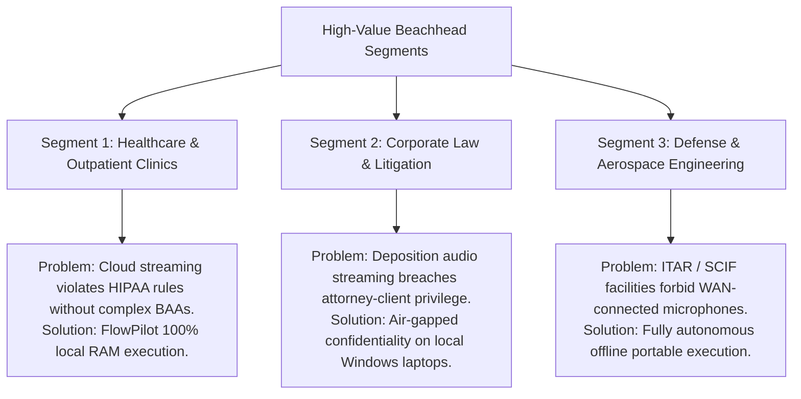

# FlowPilot 2.1 Commercial Pricing Strategy & Revenue Architecture

**Product:** FlowPilot Desktop  
**Version:** 2.1.0  
**Target Market:** Privacy-Restricted Knowledge Workers, Healthcare, Legal & Regulated Enterprises  
**Date:** October 14, 2026  
**Classification:** Commercial Strategy & Financial Modeling  

---

## 1. Executive Summary & The Local-First Margin Advantage

Cloud-based speech assistants (such as Wispr Flow) operate on precarious SaaS unit economics. By streaming every audio second and text token through third-party cloud GPUs and LLM APIs, cloud providers incur an estimated **$15 to $35 per active user per month in compute COGS**.

**FlowPilot operates with a transformative unit-economics advantage:**
- **Marginal Server / Inference Cost:** **$0.00 per user.**
- **Gross Margin:** **98%+** (excluding payment processing fees).
- **Network Vulnerability:** Zero server downtime, zero bandwidth scaling costs, zero cloud provider lock-in.

This allows FlowPilot to offer both **accessible perpetual licenses** that individual professionals love, and **high-margin recurring enterprise subscriptions** that corporate IT departments require.

---

## 2. Practical Pricing Experiment Matrix

We are launching a multi-tier pricing experiment to determine willingness-to-pay (WTP) and optimal monetization across pilot cohorts:

| Tier | Target Customer | Pricing Model | Price Point | Core Inclusions |
|:---|:---|:---:|:---:|:---|
| **Free Pilot / Community** | Exploratory users & open-source contributors | Free (14-Day Trial) | $0 | Standard `base` model, core shortcuts, up to 10 custom vocabulary entries. |
| **Professional (Pro)** | Individual developers, consultants, lawyers, writers | **Perpetual One-Time** *(or $4.99/mo)* | **$49.00** | Lifetime offline license, unlimited dictation, full writing styles, unlimited voice snippets, 1 year of updates. |
| **Team / Practice** | Boutique legal practices, engineering teams, medical clinics | **Annual Subscription / Seat** | **$12.00 / seat / mo** *(billed annually at $144)* | Centralized team glossary deployment (`personalization.json`), priority email support, commercial deployment rights. |
| **Enterprise Air-Gapped** | Healthcare hospital systems, defense contractors, financial institutions | **Annual Enterprise Agreement** | **$36.00 – $48.00 / seat / yr** *(volume tiered, min 50 seats)* | Certified Zero-Egress guarantee, Microsoft Intune MSI deployment, custom medical/legal terminology packs, enterprise SLA. |

---

## 3. Beachhead Customer Segment: Regulated Professionals

Rather than attempting to outspend consumer-focused venture-backed competitors in broad consumer advertising, FlowPilot focuses on the segment where **local-first privacy is a mandatory legal requirement**:

### 3.1 Primary Beachhead: Legal & Law Firms
- **Budget Authorization:** Partners possess discretionary expense authority ($50–$500 software purchases).
- **Core Pain:** Dictating billing entries, client correspondence, and litigation memos while maintaining non-disclosure obligations.
- **Conversion Trigger:** Demonstrating that Wispr Flow streams audio to third-party cloud servers, while FlowPilot executes 100% locally with zero network sockets.

### 3.2 Secondary Beachhead: Outpatient Healthcare Providers
- **Budget Authorization:** Practice managers and clinical administrators.
- **Core Pain:** Entering clinical notes into EHR systems without incurring HIPAA liability or paying $1,500+ for legacy Dragon Medical licenses.
- **Conversion Trigger:** Demonstrating FactGuard preservation of clinical dosages, patient dates, and negations.

---

## 4. Financial Projections & Break-Even Model (Year 1)

Assumptions: Zero inference COGS, standard digital distribution via Stripe/FastSpring.

| Metric | Conservative Case | Moderate Case | Accelerated Enterprise Case |
|:---|:---:|:---:|:---:|
| **Pro Individual Licenses ($49 one-time)** | 350 units ($17,150) | 1,200 units ($58,800) | 3,000 units ($147,000) |
| **Team Seats ($144/year)** | 50 seats ($7,200) | 250 seats ($36,000) | 750 seats ($108,000) |
| **Enterprise Site Licenses ($40/seat/year)** | 1 pilot (100 seats = $4,000) | 3 pilots (450 seats = $18,000) | 8 pilots (2,000 seats = $80,000) |
| **Total Annual Gross Revenue** | **$28,350** | **$112,800** | **$335,000** |
| **Payment Processing & Tooling (5%)** | ($1,417) | ($5,640) | ($16,750) |
| **Net Contribution Cash Flow** | **$26,933** | **$107,160** | **$318,250** |

*Key Takeaway:* Because FlowPilot does not pay third-party cloud API bills for audio transcription, over 95% of every dollar earned directly funds developer college tuition, product development, and operations.

---

## 5. Licensing & Commercial Distribution Strategy

1. **Digital Direct-to-Consumer:**
   - Distributed via a dedicated landing page (`https://flowpilot.local`) using FastSpring or LemonSqueezy for merchant-of-record global tax compliance.
   - 14-day full-feature trial without credit card requirement.
2. **Offline Hardware Licensing (OEM Bundling):**
   - Provide enterprise USB drives or pre-configured Intune packages for air-gapped corporate deployments.
   - Node-locked or domain-validated licensing keys for corporate installations.
