# FlowPilot 30-Day Commercial & Operational Execution Plan

**Objective:** Transition FlowPilot from an audited release into an active 15-user commercial pilot, convert first paying customers, and establish a repeatable path to revenue.  
**Execution Period:** Day 1 to Day 30  
**Responsible Lead:** FlowPilot Product & Engineering  

---

## 1. Executive Timeline Overview

```mermaid
gantt
    title FlowPilot 30-Day Commercial & Pilot Roadmap
    dateFormat  X
    axisFormat Day %d
    
    section Phase 1: Onboarding
    Pilot Cohort Outreach & Selection (15 users) :0, 4
    Clean Installation & Initial Task Battery    :3, 7
    
    section Phase 2: Rapid Iteration
    Mid-Point Defect Triage & SLA Fixes          :7, 12
    Extended Model & Custom Vocabulary Sync     :10, 14
    
    section Phase 3: Monetization
    Commercial Conversion & Pricing Experiments :14, 19
    First Paid Pro & Team Invoices Collected     :17, 22
    
    section Phase 4: Scale & OEM
    Enterprise Intune / MSI Packaging           :21, 26
    Exploratory OEM Outreach (Wispr / EHRs)     :24, 30
```

---

## 2. Weekly Execution Breakdown

### Week 1 (Days 1–7): Pilot Onboarding & First Value Delivery
- **Day 1–2:** Finalize 15 pilot participants across Legal (5), Healthcare Outpatient (5), and Engineering (5). Send [`PILOT_OUTREACH_KIT.md`](file:///S:/APPs/New%20folder/PILOT_OUTREACH_KIT.md).
- **Day 3:** Deliver [`FlowPilot-v2.1.0-win64.zip`](file:///S:/APPs/New%20folder/dist/FlowPilot-v2.1.0-win64.zip) and [`PILOT_QUICKSTART.md`](file:///S:/APPs/New%20folder/PILOT_QUICKSTART.md). Ensure all participants achieve their first successful dictation cycle.
- **Day 4–5:** Distribute the 6-workflow Task Battery ([`PILOT_PROGRAM_SPECIFICATION.md`](file:///S:/APPs/New%20folder/PILOT_PROGRAM_SPECIFICATION.md)).
- **Day 6–7:** Review initial feedback. Verify zero audio/transcript telemetry disclosure compliance.

### Week 2 (Days 8–14): Feedback Synthesis & Defect SLA Resolution
- **Day 8–9:** Triage incoming bug reports via [`PILOT_BUG_REPORT_TEMPLATE.md`](file:///S:/APPs/New%20folder/PILOT_BUG_REPORT_TEMPLATE.md). Enforce P0 (<24h) and P1 (<48h) SLAs.
- **Day 10–11:** Assist legal and clinical teams in populating their team dictionary (`personalization.json`) with specialized Latin citations, medical terms, and client abbreviations.
- **Day 12–13:** Conduct 10-minute mid-point check-in calls with 5 most active testers.
- **Day 14:** Administer the Mid-Pilot Satisfaction Rubric.

### Week 3 (Days 15–21): Commercial Conversion & Revenue Generation
- **Day 15–16:** Present pilot exit survey and test willingness-to-pay (WTP) against the experiment tiers in [`COMMERCIAL_PRICING_STRATEGY.md`](file:///S:/APPs/New%20folder/COMMERCIAL_PRICING_STRATEGY.md):
  - Pro Perpetual: **$49.00**
  - Team Annual: **$144.00 / seat / year**
- **Day 17–18:** Set up self-serve digital checkout via LemonSqueezy / FastSpring on the landing page ([`LANDING_PAGE_COPY.md`](file:///S:/APPs/New%20folder/LANDING_PAGE_COPY.md)).
- **Day 19–21:** Secure the first 5–10 paid individual and team conversions. Target minimum initial cash flow: **$1,500 – $3,000** dedicated directly to university tuition and infrastructure reserve.

### Week 4 (Days 22–30): Strategic OEM Outreach & Enterprise Expansion
- **Day 22–24:** Package an automated enterprise MSI / Inno Setup installer for fleet distribution across Windows endpoints.
- **Day 25–27:** Initiate exploratory, confidential outreach to corporate development and product leaders at Wispr Flow and vertical legal/EHR software vendors using [`PARTNER_PROPOSAL.md`](file:///S:/APPs/New%20folder/PARTNER_PROPOSAL.md).
- **Day 28–29:** Publish Pilot Cohort Case Study highlighting 0.00% WER and complete zero-egress compliance.
- **Day 30:** Milestone Review: Evaluate total active users, monthly recurring revenue (MRR), and plan the FlowPilot v2.2 roadmap.

---

## 3. Success Criteria & Hard Gates

| Gate # | Milestone Gate | Metric Threshold | Pass / Fail Condition |
|:---:|:---|:---:|:---:|
| **Gate 1** | Pilot Launch & Retention | $\ge$ 12 of 15 testers actively dictating daily by Day 7 | Required to proceed to commercial conversion. |
| **Gate 2** | Reliability Under Real Conditions | $\ge$ 99.0% injection success rate; 0 fatal crashes | Required before initiating paid sales. |
| **Gate 3** | Commercial Validation | $\ge$ 3 paying customers or 1 signed enterprise team LOI | Confirms product-market fit and revenue viability. |
