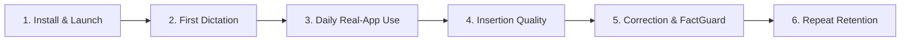

# FlowPilot 10-User, 2-Week Pilot Execution Protocol

## Purpose
This protocol provides a practical, user-centered framework to validate FlowPilot's real-world reliability across 10 non-technical users over 14 days, measuring the complete user journey: installation, first dictation, daily application use, insertion fidelity, self-correction quality, and repeat retention.

---

## 1. Pilot Cohort Profile (10 Users)

| User ID | Role / Primary Use Case | Target Applications | Operating System |
|---|---|---|---|
| **U-01** | Software Engineer | VS Code, Windows Terminal, Slack | Windows 11 (x64) |
| **U-02** | Product Manager | Notion, Google Docs (Chrome), Jira | Windows 11 (x64) |
| **U-03** | Executive Assistant | Outlook, Microsoft Word, Teams | Windows 10 (x64) |
| **U-04** | Customer Support Lead | Zendesk (Edge), Slack, Notepad | Windows 11 (x64) |
| **U-05** | Financial Analyst | Microsoft Excel, Outlook, Teams | Windows 10 (x64) |
| **U-06** | Content Writer / Marketer | Google Docs (Chrome), WordPress | Windows 11 (x64) |
| **U-07** | DevOps / SRE | PowerShell Console, Slack, GitHub Web | Windows 11 (x64) |
| **U-08** | Legal / Compliance Specialist | Microsoft Word, Adobe Acrobat, Outlook | Windows 11 (x64) |
| **U-09** | Academic Researcher | Obsidian, Overleaf (Chrome), Word | Windows 10 (x64) |
| **U-10** | Multilingual Professional | WhatsApp Desktop, Telegram, Gmail | Windows 11 (x64) |

---

## 2. The 6-Stage User Journey & Metrics



### Stage 1: Install & First Launch
- **Target:** Under 60 seconds from ZIP extract to floating HUD appearance.
- **Metric:** Zero DLL errors, zero admin/UAC barriers, zero ONNX runtime exceptions.

### Stage 2: Time to First Spoken Text
- **Action:** Open Notepad or email. Press `Ctrl+Shift+Space` (or `F9`). Speak one sentence.
- **Target:** Text appears in `< 2.0s` without cold-start stutter or silent dropped keypresses.

### Stage 3: Multi-Application Daily Insertion
- **Tracking:** Test across Microsoft 365, Google Chrome, VS Code, Slack, and Windows Terminal.
- **Metric:** Insertion Success Rate $> 99.5\%$.
- **Recovery:** If an app blocks clipboard paste, FlowPilot automatically falls back to direct `SendInput` Unicode typing. If both fail, text is preserved in clipboard with `"Paste failed (saved to clipboard)"` notification.

### Stage 4: Spoken Self-Correction & Punctuation Quality
- **Scenario:** Speak with natural filler words (*"um"*, *"like"*) and natural self-corrections (*"send the report on Monday — actually, Tuesday"*).
- **Metric:** FactGuard preserves 100% of names, technical numbers, and negations, while cleanly removing false starts.

### Stage 5: Repeat Usage & Friction Log
- **Metric:** Daily dictation count per user (Target: $\ge 15$ dictations/day per active user).
- **Log Location:** Stored locally and privately at `~/.flowpilot/dictation_telemetry.log`.

---

## 3. Local Telemetry & Diagnostic Inspection

FlowPilot automatically logs performance metrics locally without transmitting any data over the network:

- **Log Path:** `%USERPROFILE%\.flowpilot\dictation_telemetry.log`
- **Fields Captured:**
  ```json
  {
    "timestamp": 1728945600.12,
    "datetime": "2026-10-14 23:25:00",
    "target_app": "notepad.exe",
    "audio_duration_sec": 3.40,
    "stt_duration_sec": 1.68,
    "format_duration_sec": 0.02,
    "total_duration_sec": 1.70,
    "char_count": 42,
    "injection_method": "clipboard_paste",
    "injection_success": true
  }
  ```

---

## 4. 14-Day Pilot Schedule

| Phase | Days | Milestone Objective |
|---|---|---|
| **Onboarding** | Days 1–2 | Deliver `FlowPilot-v3.1.0-pilot-win64.zip` to all 10 users. Confirm successful launch on host machines. |
| **Baseline Dictation** | Days 3–5 | Users conduct 10+ daily dictations in their primary work apps. Triage any target app focus anomalies. |
| **Stress & Complex Input** | Days 6–9 | Test code dictation, numerical data, long-form paragraphs, and multilingual speech. |
| **Feedback & Iteration** | Days 10–12 | Collect local diagnostic logs. Fix any reported insertion bottlenecks. |
| **Final Review** | Days 13–14 | Retention audit: Would users continue using FlowPilot daily over their existing keyboard? |
