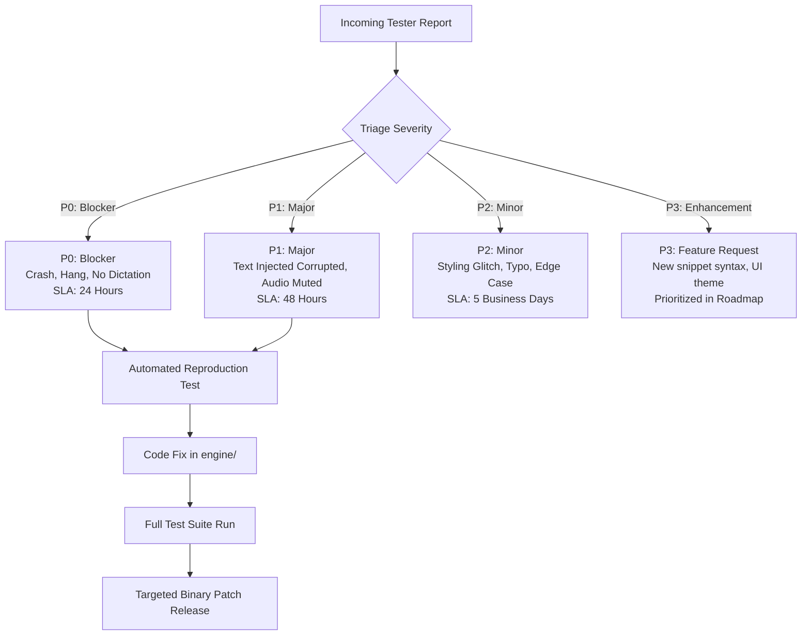

# FlowPilot Pilot Feedback Loop & Defect Prioritization Framework

**Classification:** Product Operations & Quality Assurance Process  
**Applicability:** FlowPilot v2.0.0 Commercial Pilot Evaluations  
**Owner:** Head of Product & Release QA  

---

## 1. Objectives & Feedback Collection Channels

The goal of the pilot feedback loop is to rapidly capture real-world user experiences across diverse Windows hardware configurations, isolate edge cases, and ensure enterprise-grade stability before broader market launch.

### 1.1 Collection Channels
1. **Automated Diagnostic Bundle:** Pilot testers run [`collect_diagnostics.bat`](file:///S:/APPs/New%20folder/collect_diagnostics.bat) upon encountering any hardware, audio, or hotkey issue. The script packages endpoint device state and logs into `flowpilot_diagnostic_report.txt`.
2. **Defect Submission Template:** Testers fill out [`PILOT_BUG_REPORT_TEMPLATE.md`](file:///S:/APPs/New%20folder/PILOT_BUG_REPORT_TEMPLATE.md) for structured issue intake.
3. **Weekly Pilot Check-In Survey:** A 2-minute qualitative survey evaluating dictation accuracy, speed perception, and application compatibility.

---

## 2. Defect Classification & SLA Matrix

Every reported defect or behavior anomaly is triaged into one of four severity tiers:

| Severity Level | Definition | Concrete Examples | Target Resolution SLA |
|:---|:---|:---|:---:|
| **P0 — Blocker** | Prevents core application launch, crashes Windows process, or causes unrecoverable freeze. | • Application crashes on boot. • Single-instance mutex deadlocks. • Hotkey listener crashes with unhandled Win32 exception. | **< 24 Hours** |
| **P1 — Major** | Core dictation works, but text injection fails, audio remains permanently muted, or data is corrupted. | • Injected text repeats twice. • Audio ducking fails to restore Spotify/YouTube volume. • FactGuard reverts valid user correction. | **< 48 Hours** |
| **P2 — Minor** | Dictation succeeds, but minor cosmetic, formatting, or performance degradation occurs. | • Trailing period added after CLI command. • HUD animation stutters slightly. • British English spelling missed on rare word. | **< 5 Business Days** |
| **P3 — Enhancement** | New feature, design polish, or non-critical workflow addition requested by user. | • Support for custom audio cues. • Additional UI pill themes. • Richer voice snippet expansion macros. | **Product Roadmap Backlog** |

---

## 3. Key Quantitative Pilot Outcome Metrics

We track four foundational telemetry-free metrics during each 14-day pilot evaluation:

### Metric 1: Injection Reliability Rate (Target: $\ge$ 99.5%)
$$\text{Reliability} = \frac{\text{Successful Injections}}{\text{Total Recording Cycles Initiated}} \times 100$$
- *Measurement:* Derived from tester checklist logs and automated Notepad injection suites.

### Metric 2: FactGuard Meaning Preservation Rate (Target: 100.0%)
- *Measurement:* Zero accidental omissions of numbers, dates, currency tokens, or critical negations.

### Metric 3: Time-to-Insert (End-to-End Latency) (Target: $\le$ 1,500 ms)
- *Measurement:* Elapsed duration from hotkey release (speech stop) to text rendering in the active foreground window on CPU.

### Metric 4: User Satisfaction (CSAT) (Target: $\ge$ 4.5 / 5.0)
- *Measurement:* Score collected across 3 dimensions: Perceived Speed, Transcription Accuracy, and Focus Stability.

---

## 4. Defect Triage & Resolution Protocol

When a pilot tester submits a defect report:

1. **Step 1: Reproduction via Test Harness:**
   - The engineering team creates a new targeted test script in `tests/` reproducing the exact failure mode (e.g. reproducing a new hardware sample rate or rare keyboard modifier order).
2. **Step 2: Regression Suite Verification:**
   - The fix is implemented in `engine/`.
   - The complete automated suite (`tests/run_all_tests.py` and `tests/test_final_specification_e2e.py`) must pass with 100% green status.
3. **Step 3: Standalone Binary Rebuild:**
   - PyInstaller compiles the updated standalone binary to `dist/FlowPilot/FlowPilot.exe`.
   - A clean-install smoke test is executed to verify binary packaging integrity.
4. **Step 4: Hotfix Deployment & Closed-Loop Notification:**
   - An updated distribution zip is delivered to the pilot tester with the specific test case verified.
   - The defect status is updated in [`flowpilot_known_issues.md`](file:///S:/APPs/New%20folder/flowpilot_known_issues.md) and [`FLOWPILOT_CHANGELOG.md`](file:///S:/APPs/New%20folder/FLOWPILOT_CHANGELOG.md).
