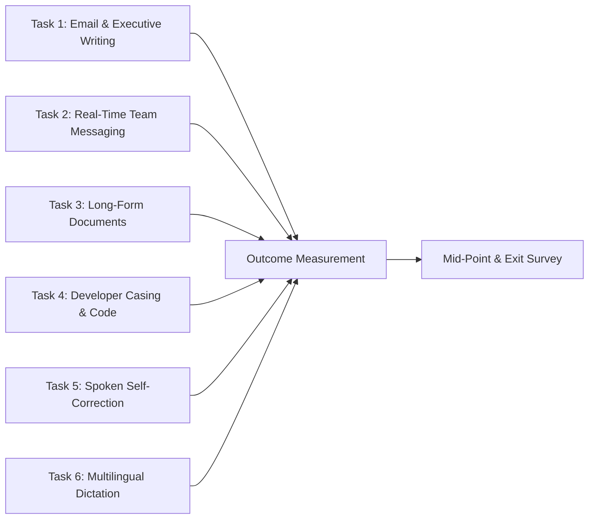

# FlowPilot 2.1 Pilot Program Specification & Evaluation Protocol

**Document Version:** 2.1.0  
**Target Cohort:** 10–20 Qualified Enterprise & Professional Knowledge Workers  
**Evaluation Duration:** 14 Calendar Days per Participant  
**Applicable Build:** [`dist/FlowPilot-v2.1.0-win64.zip`](file:///S:/APPs/New%20folder/dist/FlowPilot-v2.1.0-win64.zip)  
**Classification:** Pilot Operations, Privacy & Outcome Measurement  

---

## 1. Cohort Structure & Participant Personas

The pilot program is designed to evaluate FlowPilot across 10 to 20 representative users distributed across three high-value personas:

| Cohort Segment | Target Size | Primary Applications | Core Workflow Needs |
|:---|:---:|:---|:---|
| **Segment A: Healthcare & Clinical** | 4–6 Testers | EHR portals, Epic, Cerner, Word, Clinical Notes | High accuracy on medical terminology, patient privacy, zero cloud transmission. |
| **Segment B: Legal & Corporate Counsel** | 4–6 Testers | Outlook, Word, Clio, PDF markup, Contract drafting | Attorney-client privilege preservation, accurate quotation punctuation, date/number precision. |
| **Segment C: Software & Cloud Engineers** | 4–8 Testers | VS Code, Windows Terminal, Slack, Jira, GitHub | `camelCase` / `snake_case` casing, technical acronyms, rapid messaging dictation. |

---

## 2. Onboarding Workflow & Zero-Telemetry Disclosure

### 2.1 Privacy & Consent Policy
FlowPilot is architected with **zero telemetry collection**. To maintain absolute data sovereignty:
- FlowPilot does **NOT** record, stream, or store participant microphone audio on disk or external servers.
- FlowPilot does **NOT** log or transmit dictated text transcripts.
- System diagnostics are generated **only** when the user explicitly double-clicks [`collect_diagnostics.bat`](file:///S:/APPs/New%20folder/collect_diagnostics.bat) and chooses to share the resulting text report.
- Participation is voluntary and subject to standard pilot evaluation agreements.

### 2.2 3-Step Participant Onboarding
1. **Download & Extract:** Participant downloads and extracts [`FlowPilot-v2.1.0-win64.zip`](file:///S:/APPs/New%20folder/dist/FlowPilot-v2.1.0-win64.zip) (or runs [`start_desktop.bat`](file:///S:/APPs/New%20folder/start_desktop.bat)).
2. **First Run & Audio Cue Verification:** Double-click [`FlowPilot.exe`](file:///S:/APPs/New%20folder/dist/FlowPilot/FlowPilot.exe). Confirm the floating microphone pill appears at the top center of the screen within 1.5 seconds.
3. **Hotkey Alignment:** Confirm primary shortcut (`Ctrl + Shift + Space`) or push-to-talk (`F9`).

---

## 3. Representative Task Battery (6 Structured Workflows)

Pilot testers are requested to execute the following 6 core tasks during their 14-day evaluation:

### Task 1: Email & Executive Communication
- **Target Apps:** Microsoft Outlook, Mozilla Thunderbird, Gmail web client.
- **Goal:** Dictate professional correspondence, meeting requests, and executive updates.
- **Evaluation Criteria:** Appropriate capitalization, sentence structure, lack of filler words (`um`, `uh`).

### Task 2: Real-Time Team Messaging
- **Target Apps:** Slack, Microsoft Teams, Discord.
- **Goal:** Dictate rapid, informal team chats, standup updates, and direct messages.
- **Evaluation Criteria:** Fast latency (<1.2s), natural punctuation without unwanted trailing periods on short phrases.

### Task 3: Technical Documentation & Long-Form Writing
- **Target Apps:** Microsoft Word, Obsidian, Notion, Google Docs.
- **Goal:** Dictate multi-paragraph reports, memos, and architectural summaries.
- **Evaluation Criteria:** Continuous dictation flow, sustained focus preservation across window switches.

### Task 4: Developer Coding & Identifier Dictation
- **Target Apps:** Visual Studio Code, Visual Studio, JetBrains IDEs, Windows Terminal.
- **Goal:** Dictate code identifiers using technical casing commands (e.g., *"create camel case user profile and snake case auth token"*).
- **Evaluation Criteria:** Correct generation of `userProfile` and `auth_token`.

### Task 5: Spoken Self-Correction & Negation Verification
- **Target Apps:** Any active text editor.
- **Goal:** Intentionally speak corrections mid-utterance (e.g., *"Schedule the meeting for Monday -- actually, Tuesday at 3 PM"* and *"Do not approve the invoice -- actually, approve it"*).
- **Evaluation Criteria:** Clean substitution of superseded terms, exact preposition retention, and FactGuard negation safety.

### Task 6: Multilingual Dictation & Regional Accents
- **Target Apps:** Any active text editor.
- **Goal:** Dictate in preferred non-English languages (Spanish, German, French, etc.) or regional English dialects (British vs. American).
- **Evaluation Criteria:** Correct script characters, accents, and dialectal spelling conventions.

---

## 4. Quantitative & Qualitative Outcome Metrics

The following metrics are collected through the repeatable pilot checklist and periodic check-ins:

### Quantitative Metrics:
1. **Total Dictations Initiated:** Target $\ge$ 20 dictations per participant per week.
2. **Text Insertion Success Rate:** $\frac{\text{Successful Injections}}{\text{Total Sessions}} \ge 99.0\%$.
3. **Self-Correction Accuracy:** Percentage of mid-sentence speech corrections resolved without manual backspacing (Target $\ge$ 95.0%).
4. **Clipboard Restoration Reliability:** Zero instances of lost pre-dictation clipboard contents.
5. **Observed Crash / Freeze Count:** Target: 0 fatal crashes across all pilot sessions.

### Qualitative & Commercial Feedback Questions (Exit Survey):
1. **Continuation Intent:** *"If FlowPilot became unavailable tomorrow, how would you feel?"*
   - [ ] Very disappointed (Strong product-market fit indicator)
   - [ ] Somewhat disappointed
   - [ ] Not disappointed
2. **Willingness to Pay (WTP):**
   - *"What would be an acceptable monthly or one-time price for your team/organization to continue using FlowPilot?"*
     - [ ] $29 – $49 (One-time perpetual license)
     - [ ] $5 – $10 / month (Individual SaaS)
     - [ ] $15 – $25 / month (Enterprise tier with centralized dictionary)
     - [ ] $0 (Would only use if free)
3. **Primary Value Proposition:** *"What was the single most valuable aspect of FlowPilot compared to typing or other dictation tools?"*
   - [ ] Complete local privacy (Zero cloud streaming)
   - [ ] Spoken self-correction & writing polish
   - [ ] Speed and zero-lag hotkey response
   - [ ] Lightweight footprint (doesn't slow down laptop)

---

## 5. Defect Escalation & SLA Protocol

Issues reported via [`PILOT_BUG_REPORT_TEMPLATE.md`](file:///S:/APPs/New%20folder/PILOT_BUG_REPORT_TEMPLATE.md) follow the strict resolution SLAs established in [`PILOT_FEEDBACK_FRAMEWORK.md`](file:///S:/APPs/New%20folder/PILOT_FEEDBACK_FRAMEWORK.md):
- **P0 (Blocker):** Immediate reproduction test and hotfix within 24 hours.
- **P1 (Major):** Target resolution within 48 hours.
- **P2 (Minor):** Addressed in weekly pilot update release.
