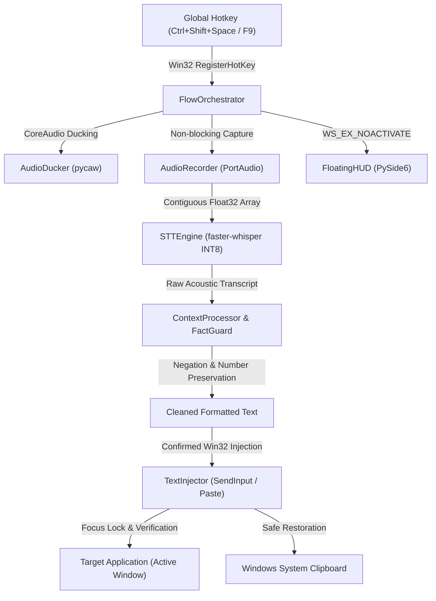

<div align="center">

# FlowPilot ⚡

### Universal High-Performance Voice Dictation for Windows
**100% Offline • Zero Latency • Native Win32 • Zero Data Egress**

[](LICENSE)
[-0078D6.svg?logo=windows)](https://microsoft.com)
[-orange.svg)](https://github.com/SYSTRAN/faster-whisper)
[](https://www.qt.io/)
[](PRIVACY.md)

</div>

---

## 📖 Overview

**FlowPilot** is an open-source, ultra-low-latency desktop voice dictation assistant built specifically for Windows power users, engineers, and privacy-conscious professionals.

Inspired by tools like *Wispr Flow* and *Superwhisper*, FlowPilot delivers seamless voice-to-text directly at your cursor in **any application** (VS Code, Chrome, Slack, Obsidian, Word, Terminal, and Notepad) — without cloud subscriptions, without network latency, and without sending private screen captures or audio recordings to remote servers.

---

## ✨ Key Capabilities

| Feature | Description |
|:---|:---|
| 🔒 **100% Offline & Private** | Powered by local `faster-whisper` INT8 on CPU. Zero network egress. No accounts, no telemetry, no cloud dependencies. |
| ⚡ **Sub-Second Latency** | Optimized end-to-end pipeline with direct float32 audio streaming, greedy decoding, and instant Win32 text injection (~1.2s stop-to-text). |
| 🎙️ **Wispr Flow Experience** | Choose between **F9 Push-to-Talk** (hold, speak, release to insert) or **Ctrl+Shift+Space Toggle** with automatic silence finalization. |
| 🛡️ **FactGuard™ & Writing Intelligence** | Deterministic rule-based post-processing: removes stutter and fillers (`um`, `uh`), cleans repeated words, auto-punctuates, and guarantees numbers, dates, negations, and technical symbols are never altered. |
| 🔇 **CoreAudio Background Ducking** | Automatically lowers background music/media (Spotify, YouTube, Discord) while speaking, then seamlessly restores volume. |
| 🧩 **Focus-Preserving HUD** | Frosted floating microphone pill engineered with `WS_EX_NOACTIVATE` — it visually guides your dictation state without stealing cursor focus from your active app. |
| 📋 **Non-Destructive Clipboard Safety** | Preserves and restores existing clipboard content after text insertion; includes a manual fallback buffer via the System Tray. |
| 💻 **Developer Vocabulary Biasing** | Built-in terminology dictionary biasing for code terms (`Kubernetes`, `GraphQL`, `FastAPI`, `Pydantic`, `TypeScript`, `Docker`, `PostgreSQL`). |

---

## 🚀 Quick Start (Choose Your Preferred Method)

### Method A: Standalone Packaged Release (Recommended for End Users)
*No Python or compiler required.*

1. Download **`FlowPilot-v3.0.2-win64.zip`** from the latest release.
2. Extract the ZIP archive to any folder on your PC (e.g., `C:\Tools\FlowPilot` or `S:\FlowPilot`).
3. Double-click **`FlowPilot.exe`**.
4. The floating HUD pill will appear at the bottom center of your screen, and the FlowPilot icon will sit in your System Tray.

### Method B: Running from Source (For Developers)

```powershell
# 1. Clone repository
git clone https://github.com/abishekvr0910/flowpilot.git
cd flowpilot

# 2. Create virtual environment
python -m venv .venv
.\.venv\Scripts\Activate.ps1

# 3. Install dependencies
pip install -r requirements.txt

# 4. Launch FlowPilot
python desktop_app.py
```

---

## 🎙️ How to Dictate

1. **Place your cursor** into any text field or editor (VS Code, Notepad, Browser, Discord, Word).
2. **Activate FlowPilot**:
   - **Toggle Mode (Default):** Press **`Ctrl + Shift + Space`**. The HUD glows cyan indicating active listening. Speak naturally. Press **`Ctrl + Shift + Space`** again (or pause for 0.85s) to finalize.
   - **Push-to-Talk Mode:** Press and hold **`F9`**. Speak your thought. Release **`F9`** to finalize.
3. FlowPilot transcribes, polishes, and types the text directly at your cursor.
4. **Emergency Recovery:** If target application blocks clipboard pasting, your dictation is safely held in memory. Simply right-click the System Tray icon and select **"Copy Last Dictation"**.

---

## ⚙️ Configuration & Customization

FlowPilot stores its configuration locally in your user profile:
`%USERPROFILE%\.flowpilot\config.json`

You can customize settings via the System Tray context menu (**Right-Click Tray Icon → Settings**) or by editing `config.json` directly:

```json
{
  "engine_mode": "local",
  "local_model_size": "base",
  "language": "en",
  "hotkey": "<ctrl>+<shift>+<space>",
  "hotkey_mode": "toggle",
  "active_tone_mode": "developer",
  "auto_stop_on_silence": true,
  "silence_timeout_sec": 0.85,
  "custom_vocabulary": [
    "Kubernetes", "GraphQL", "FastAPI", "Pydantic", "PostgreSQL",
    "Next.js", "TypeScript", "Python", "Whisper", "Docker"
  ],
  "telemetry_enabled": false,
  "save_history_text": false
}
```

### Available Tone Modes
- **`developer`** (Default): Preserves code identifiers, acronyms, and formatting while cleaning vocal fillers.
- **`cleaned`**: Standard conversational cleanup with natural punctuation and capitalization.
- **`verbatim`**: 100% exact acoustic transcript — zero filler removal or rewriting.
- **`casual`**: Conversational tone preserving expressive language.
- **`email`**: Structured business formatting.

---

## 🏗️ Architecture



---

## 🔧 Troubleshooting & FAQ

#### Win32 Hotkey Error 1409 (`ERROR_HOTKEY_ALREADY_REGISTERED`)
- **Cause:** Another running application (e.g., PowerToys, Discord, or an older instance of FlowPilot) is already listening to `Ctrl+Shift+Space`.
- **Solution:** Right-click the Tray icon, open **Settings**, and switch your shortcut to `Ctrl+Alt+Space` or `F9`. FlowPilot includes single-instance mutex enforcement to prevent duplicate background processes.

#### Microphone Not Capturing Sound
- Open Windows **Settings → Privacy & security → Microphone** and verify that desktop apps are permitted to access your microphone.
- FlowPilot automatically detects your default Windows recording device.

#### Text Doesn't Paste into an Elevated Application (Administrator Terminal)
- Under Windows security architecture (UAC), a standard user process cannot inject input into an Administrator/elevated window.
- **Solution:** Launch FlowPilot as Administrator if you frequently dictate into elevated command prompts or terminals.

---

## 🔒 Privacy & Security

FlowPilot is built on a **Zero Network Egress** guarantee:
- **No Remote Servers:** Speech inference runs 100% locally on your machine via CPU INT8.
- **Zero Screenshots:** FlowPilot never inspects or captures screen images.
- **No Cloud Telemetry:** Diagnostic telemetry is disabled by default.
- **Volatile Storage:** Audio buffers and transcripts are kept in RAM and discarded immediately after insertion.

Read our complete [PRIVACY.md](PRIVACY.md) and [SECURITY.md](SECURITY.md) documents.

---

## 📜 Licensing & Attribution

FlowPilot application code is released under the **MIT License**. See [LICENSE](LICENSE) for details.

FlowPilot bundles third-party open-source components including:
- **PySide6 / Qt 6** (LGPL v3 — dynamically linked, user relinking supported)
- **faster-whisper** (MIT License, SYSTRAN)
- **CTranslate2** (MIT License, OpenNMT)
- **Silero VAD** (MIT License, Silero Team)
- **sounddevice & PortAudio** (MIT / PortAudio License)

See [THIRD_PARTY_LICENSES.md](THIRD_PARTY_LICENSES.md) for full license texts and attributions.
