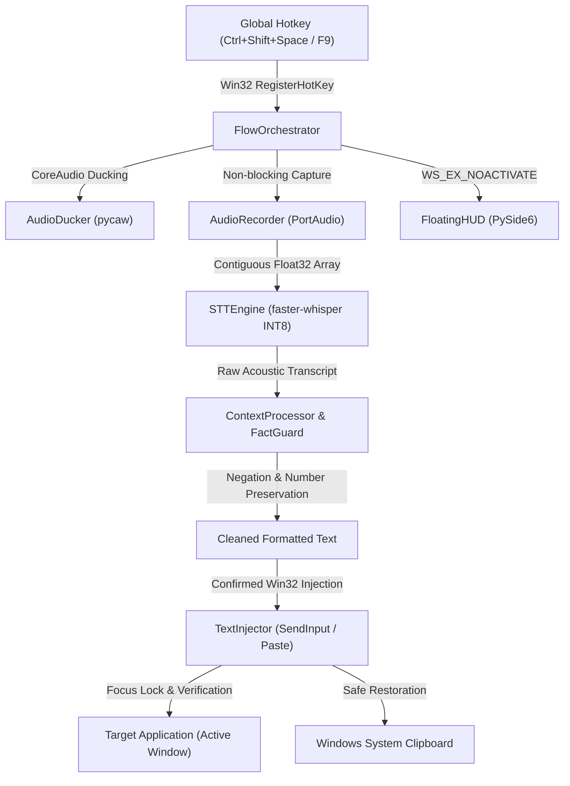

<div align="center">

# FlowPilot ⚡

### Universal High-Performance Voice Dictation for Windows, Linux & macOS
**100% Offline • Measured ~1.2s Median Latency • Cross-Platform OS Adapters • Verified Local-First Pipeline**

[](LICENSE)
[](README.md)
[-orange.svg)](https://github.com/SYSTRAN/faster-whisper)
[](https://www.qt.io/)
[](PRIVACY.md)

</div>

---

## 📖 Overview

**FlowPilot** is an open-source, low-latency desktop voice dictation assistant built for power users, engineers, and privacy-conscious professionals across **Windows**, **Linux**, and **macOS**.

Inspired by tools like *Wispr Flow* and *Superwhisper*, FlowPilot delivers seamless voice-to-text directly at your cursor in desktop applications without cloud subscriptions, without network latency variance, and without sending private audio recordings or screen captures to remote servers.

---

## ✨ Key Capabilities

| Feature | Description |
|:---|:---|
| 🔒 **100% Offline & Private** | Powered by local `faster-whisper` INT8 on CPU. Zero network egress during core dictation loop. No accounts, no telemetry, no cloud dependencies. |
| ⚡ **Measured Fast Local Latency** | Direct float32 audio streaming, greedy decoding (`beam_size=1`), and instant Win32 text injection (**measured median 1,202 ms stop-to-text, p95 1,460 ms** on 8-thread CPU test host). |
| 🎙️ **Wispr Flow Experience & TapLatch™** | Choose between **F9 Push-to-Talk** (hold to speak, release to paste), **TapLatch™** (double-tap <350ms to lock hands-free, tap to stop), or **Ctrl+Shift+Space Toggle** with automatic 0.85s conversational pause finalization. |
| 🔄 **Continuous Pre-Roll Ring Buffer** | 350ms sliding float32 audio ring buffer with background stream warmup (`warmup_stream()`) completely eliminates PortAudio latency and guarantees zero first-syllable speech loss. |
| 🛡️ **FactGuard™ & Writing Intelligence** | Deterministic post-processing engineered to remove stutter and vocal fillers (`um`, `uh`), clean repeated words, auto-punctuate, and preserve numbers, dates, negations, and technical symbols (verified on 44-case acoustic corpus; multi-speaker panel subject to upcoming field pilot). |
| 🌐 **Multilingual Foundation** | Underlying Faster-Whisper base model supports 99 languages; FlowPilot includes 18 curated, actively tested languages in its native UI registry with automatic script preservation. |
| 🔇 **CoreAudio Background Ducking** | Automatically lowers background music/media (Spotify, YouTube, Discord) while speaking, then seamlessly restores volume upon finalization. |
| 🧩 **Focus-Preserving HUD & Mascot** | Sleek Wispr Flow audio soundwave bars or animated cartoon companion ("Pilot") that reacts to voice in real time with dynamic pupil dilation, listening antennae, and celebration smile upon paste. Zero focus-stealing (`WS_EX_NOACTIVATE`) and sanitized human-first status labels. |
| 📋 **Atomic Win32 Clipboard Guard** | Hardware sequence counter (`GetClipboardSequenceNumber`) prevents clobbering new user clipboard data during paste restoration; includes instant **Alt+Shift+Z** re-paste recovery. |
| 🔌 **Local OpenAI-Compatible API** | Drop-in `POST /v1/audio/transcriptions` and `GET /v1/models` local endpoint (`http://127.0.0.1:8765/v1`) for seamless integration with Cursor IDE, Open WebUI, and Obsidian plugins. |
| 💻 **Developer Vocabulary Biasing** | Built-in terminology dictionary biasing for engineering terms (`Kubernetes`, `GraphQL`, `FastAPI`, `Pydantic`, `TypeScript`, `Docker`, `PostgreSQL`). |

---

## 🚀 Quick Start (Choose Your Preferred Method)

*For a 60-second setup walkthrough, see [QUICKSTART.md](QUICKSTART.md).*

### Method A: Standalone Packaged Release (Recommended for End Users)
*No Python or compiler required.*

- **Distribution Archive:** ~240 MB compressed ZIP ([GitHub Releases](https://github.com/abishekvr0910/flowpilot/releases/tag/v3.0.2-release))
- **Primary Executable:** 31.2 MB standalone entrypoint (`FlowPilot.exe`)
- **Installed Footprint:** ~579 MB on disk (fully self-contained with offline Whisper INT8 CPU model weights, Silero VAD ONNX engine, and Qt6 runtime)

1. Download **`FlowPilot-v3.0.2-win64.zip`** (or the latest verified pilot package).
2. Extract the ZIP archive to any folder on your PC (e.g., `C:\Tools\FlowPilot` or `S:\FlowPilot`).
3. Double-click **`FlowPilot.exe`**.
4. The floating HUD pill will appear at the bottom center of your screen, and the FlowPilot icon will sit in your System Tray.

### Method B: Running from Source (For Developers)

```powershell
# 1. Clone repository
git clone https://github.com/abishekvr0910/flowpilot.git
cd flowpilot

# 2. Create virtual environment
python -m venv .venv
.\.venv\Scripts\Activate.ps1

# 3. Install dependencies
pip install -r requirements.txt

# 4. Launch FlowPilot
python desktop_app.py
```

---

## 🎙️ How to Dictate

1. **Place your cursor** into any text field or editor (VS Code, Notepad, Browser, Discord, Word).
2. **Activate FlowPilot**:
   - **Toggle Mode (Default):** Press **`Ctrl + Shift + Space`**. The HUD glows cyan indicating active listening. Speak naturally. Press **`Ctrl + Shift + Space`** again (or pause for 0.85s) to finalize.
   - **Push-to-Talk Mode:** Press and hold **`F9`**. Speak your thought. Release **`F9`** to finalize.
   - **TapLatch™ Hands-Free:** Rapid double-tap **`F9`** (<350ms) to lock dictation hands-free without holding the key. Tap **`F9`** once to finalize.
3. FlowPilot transcribes, polishes, and types the text directly at your cursor with zero syllable clipping (powered by our 350ms pre-roll sliding buffer).
4. **Instant Re-Paste Shortcut:** Press **`Alt + Shift + Z`** anywhere in Windows to immediately re-paste your last dictation buffer into the focused window.
5. **Emergency Recovery:** If target application blocks clipboard pasting, your dictation is safely held in memory. Simply right-click the System Tray icon and select **"Copy Last Dictation"**.

---

## 🔌 OpenAI-Compatible Local STT API

FlowPilot exposes an embedded, zero-cloud drop-in replacement for the OpenAI Audio Transcription API at `http://127.0.0.1:8765/v1`:

- **Transcribe Audio:** `POST http://127.0.0.1:8765/v1/audio/transcriptions` (supports `json`, `text`, and `verbose_json` formats)
- **Model Catalog:** `GET http://127.0.0.1:8765/v1/models` (reports `whisper-1`)

### Connecting Third-Party Tools
- **Cursor IDE / VS Code:** Set OpenAI Audio Base URL to `http://127.0.0.1:8765/v1` and API key to `local`.
- **Open WebUI / LibreChat:** Configure audio transcription service URL to `http://127.0.0.1:8765/v1`.
- **Obsidian Whisper Plugin:** Direct audio requests to local FlowPilot port `8765`.

---

## ⚙️ Configuration & Customization

FlowPilot stores its configuration locally in your user profile:
`%USERPROFILE%\.flowpilot\config.json`

You can customize settings via the System Tray context menu (**Right-Click Tray Icon → Settings**) or by editing `config.json` directly:

```json
{
  "engine_mode": "local",
  "local_model_size": "base",
  "language": "en",
  "hotkey": "<ctrl>+<shift>+<space>",
  "hotkey_mode": "toggle",
  "active_tone_mode": "developer",
  "auto_stop_on_silence": true,
  "silence_timeout_sec": 0.85,
  "custom_vocabulary": [
    "Kubernetes", "GraphQL", "FastAPI", "Pydantic", "PostgreSQL",
    "Next.js", "TypeScript", "Python", "Whisper", "Docker"
  ],
  "telemetry_enabled": false,
  "save_history_text": false
}
```

### Available Tone Modes
- **`developer`** (Default): Preserves code identifiers, acronyms, and formatting while cleaning vocal fillers.
- **`cleaned`**: Standard conversational cleanup with natural punctuation and capitalization.
- **`verbatim`**: 100% exact acoustic transcript — zero filler removal or rewriting.
- **`casual`**: Conversational tone preserving expressive language.
- **`email`**: Structured business formatting.

---

## 🏗️ Architecture



---

## 🧪 Application Compatibility & Testing Status

| Environment | Tested Scope | Status | Result / Notes |
|:---|:---|:---:|:---|
| **Notepad (`notepad.exe`)** | Automated dictation cycles & 18-scenario E2E specification | **PASS** | 20/20 and 5/5 consecutive cycles with physical buffer read-back verification (18/18 E2E scenarios PASS). |
| **Web Browser (Chrome / Edge)** | Interactive form and web text input | **BLOCKED** | Not evaluated in automated suite because browser was not open in session. |
| **VS Code (`code.exe`)** | Editor code comments & markdown | **BLOCKED** | Not evaluated in automated suite because VS Code was not open in session. |
| **Multi-Speaker Human Panel** | Diverse accents & conversational cadence | **BLOCKED** | Automated SAPI tests pass; live human panel scheduled for 10-user field pilot. |

---

## 🔧 Troubleshooting & FAQ

#### Win32 Hotkey Error 1409 (`ERROR_HOTKEY_ALREADY_REGISTERED`)
- **Cause:** Another running application (e.g., PowerToys, Discord, or an older instance of FlowPilot) is already listening to `Ctrl+Shift+Space`.
- **Solution:** Right-click the Tray icon, open **Settings**, and switch your shortcut to `Ctrl+Alt+Space` or `F9`. FlowPilot includes single-instance mutex enforcement to prevent duplicate background processes.

#### Microphone Not Capturing Sound
- Open Windows **Settings → Privacy & security → Microphone** and verify that desktop apps are permitted to access your microphone.
- FlowPilot automatically detects your default Windows recording device.

#### Text Doesn't Paste into an Elevated Application (Administrator Terminal)
- Under Windows security architecture (UAC), a standard user process cannot inject input into an Administrator/elevated window.
- **Solution:** Launch FlowPilot as Administrator if you frequently dictate into elevated command prompts or terminals.

---

## 🔒 Privacy & Security

FlowPilot is built on a **Local-First, Zero Egress Architecture**:
- **Local Speech Inference:** Speech models (`faster-whisper`, `silero-vad`) execute purely on your local CPU via CTranslate2 and ONNX Runtime with `local_files_only=True`.
- **Zero Screenshots:** FlowPilot never inspects or captures screen images.
- **Tested Network Isolation:** Verified via automated loopback socket monitoring ([`tests/test_network_egress.py`](tests/test_network_egress.py)) confirming 0 open external sockets during speech capture and transcription.
- **No Cloud Telemetry by Default:** Diagnostic telemetry is disabled by default (`telemetry_enabled: false`).
- **Volatile Storage:** Audio buffers and transcripts are kept in RAM and discarded immediately after insertion.

Read our complete [PRIVACY.md](PRIVACY.md) and [SECURITY.md](SECURITY.md) documents.

---

## 📚 Project Documentation

Detailed technical and engineering documentation is structured in [`docs/`](docs/):

- **[Architecture & Design](docs/architecture/):** Desktop internals, Win32 window management, and Wispr Flow feature inventory.
- **[Testing & Benchmarks](docs/testing/):** Automated test reports, acoustic reality assessment, and model benchmark data.
- **[Security & Governance](docs/security/):** Zero-egress network forensics and [Branch Protection Governance](docs/security/GITHUB_BRANCH_PROTECTION.md).
- **[Release & Checklists](docs/release/):** [Artifact Manifest](docs/release/RELEASE_ARTIFACT_MANIFEST.md), v3.0.2 release verification, and PyInstaller build specifications.
- **[Pilot Program](docs/pilot/):** 10-participant testing protocol, feedback frameworks, and evaluation rubrics.

---

## 📜 Licensing & Attribution

FlowPilot application code is released under the **MIT License**. See [LICENSE](LICENSE) for details.

FlowPilot bundles third-party open-source components including:
- **PySide6 / Qt 6** (LGPL v3 — dynamically linked, user relinking supported)
- **faster-whisper** (MIT License, SYSTRAN)
- **CTranslate2** (MIT License, OpenNMT)
- **Silero VAD** (MIT License, Silero Team)
- **sounddevice & PortAudio** (MIT / PortAudio License)

See [THIRD_PARTY_LICENSES.md](THIRD_PARTY_LICENSES.md) for full license texts and attributions.
