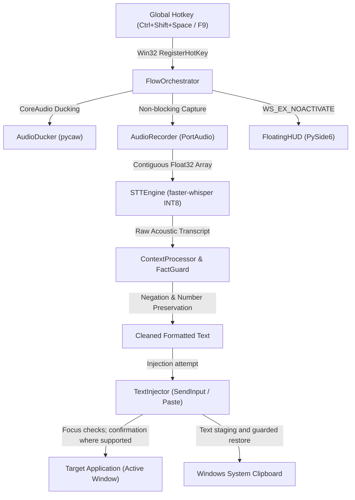

<div align="center">

# FlowPilot ⚡

### Local-first voice dictation for Windows
CPU speech recognition, cursor insertion, and a native PySide6 desktop interface.

[Get started](QUICKSTART.md) · [Evaluate trust and privacy](TRUST.md) · [Get help](SUPPORT.md) · [Verify a download](docs/release/RELEASE_ARTIFACT_MANIFEST.md)

[](LICENSE)
[](README.md)
[-orange.svg)](https://github.com/SYSTRAN/faster-whisper)
[](https://www.qt.io/)
[](https://github.com/abishekvr0910/flowpilot/actions/workflows/ci.yml)

</div>

---

## 📖 Overview

**FlowPilot** is an open-source, local-first desktop voice dictation assistant built for power users, developers, and privacy-conscious professionals.

FlowPilot transcribes speech on the user's machine and inserts text at the active cursor. The published download is [v3.0.2 for Windows](https://github.com/abishekvr0910/flowpilot/releases/tag/v3.0.2-release); the current `master` source contains newer pilot features that are not part of that release. For the current source's local storage behavior, read [PRIVACY.md](PRIVACY.md) before use.

---

## ✨ Key Capabilities

| Feature | Description |
|:---|:---|
| 🔒 **Local speech recognition** | Uses `faster-whisper` INT8 on CPU. Cloud STT branches are disabled in current source; the network regression test covers selected dictation paths. Dictation history is off by default. |
| 🔌 **Optional local transcription API** | A separately started, token-protected subset of OpenAI-style audio endpoints on `127.0.0.1:8765`. Client compatibility must be tested individually. |
| 🛡️ **FactGuard™ & Writing Intelligence** | Deterministic post-processing engineered to remove stutter and vocal fillers (`um`, `uh`), clean repeated words, auto-punctuate, and preserve numbers, dates, negations, and technical symbols. |
| 🤖 **Optional Local LLM Pass** | Current source can connect to a separately installed localhost model service such as Ollama or LM Studio for command and tone transforms. Offline behavior also depends on that service's configuration. **Target Safety:** Selected-Text Transforms (`Ctrl+Alt+T`) use highlighted text or the last dictation buffer; **`Alt+Shift+Z`** is the recovery shortcut for the last dictation, subject to target-app behavior. |
| ⚡ **Measured latency** | The [v3.0.2 release evaluation](docs/release/FLOWPILOT_V302_RELEASE_REPORT.md) reports 1,202 ms median and 1,460 ms p95 from stop action to visible text on one 8-thread Windows test host. These are historical host measurements, not a guarantee for current `master` or other hardware. |
| 🎙️ **Flexible Voice Controls & TapLatch™** | Choose between **F9 Push-to-Talk** (hold to speak, release to paste), **TapLatch™** (double-tap <350ms to lock hands-free, tap to stop), or **Ctrl+Shift+Space Toggle** with automatic 0.85s conversational pause finalization. |
| 🔄 **Continuous Pre-Roll Ring Buffer** | A 350 ms sliding float32 buffer and background stream warmup are designed to reduce first-syllable clipping; microphone and system timing still vary. |
| 📋 **Clipboard restoration & recovery** | Windows sequence checks help preserve newer user copies during delayed text restoration. Rich clipboard formats are not fully preserved; **Alt+Shift+Z** requests recovery. |
| 💻 **Developer Vocabulary Biasing** | Built-in terminology dictionary biasing for engineering terms (`Kubernetes`, `GraphQL`, `FastAPI`, `Pydantic`, `TypeScript`, `Docker`, `PostgreSQL`). |
| 📝 **Meeting Notetaker & History Vault** | Current `master` includes meeting notes and an opt-in dictation vault for local transcripts and `.wav` audio. Meeting-note storage is separate. These features are newer than the published v3.0.2 release. |
| 🐾 **Customizable Desktop Companions** | Moveable desktop companions that sit anywhere on your screen (snaps to any corner/edge with zero text clutter). Includes the **SondeR-Cat Pixel Kitty** (with 10 fur palettes and audio-reactive kneading paws), **Robot Mascot ("Pilot")**, **Retro Pixel Companions (Fox, Dino, Ghost, Bunny)**, and custom pixel art. Uses `WS_EX_NOACTIVATE` to preserve editor focus; validate behavior in your target apps. |

---

## 🚀 Quick Start (Choose Your Preferred Method)

*For model setup, a first dictation, and recovery instructions, see [QUICKSTART.md](QUICKSTART.md).*

### Method A: Standalone Packaged Release (Windows)
*No Python or compiler required.*

- **Distribution Archive:** ~240 MB compressed ZIP ([GitHub Releases](https://github.com/abishekvr0910/flowpilot/releases/tag/v3.0.2-release))
- **Primary Executable:** `FlowPilot.exe` inside the extracted Windows archive.

1. Download **`FlowPilot-v3.0.2-win64.zip`** from the release page and extract it.
2. Run **`FlowPilot.exe`** from the extracted folder.
3. The **Pilot Companion** appears on your desktop (draggable anywhere, snaps to any corner), and the FlowPilot icon will sit in your System Tray.

### Method B: Running the current source

```powershell
# Windows, with Python 3.11+ and audio dependencies available
python -m venv .venv
.\.venv\Scripts\Activate.ps1
pip install -r requirements.txt
python desktop_app.py
```

The current runtime requires locally provisioned model weights. Follow the [source setup instructions](QUICKSTART.md#running-current-source) before launching on a fresh machine. VB-Cable and traffic-capture software are benchmark tools; normal dictation does not need them.

Linux and macOS adapters exist in the source, but the published artifact and primary verification target Windows. See [QUICKSTART.md](QUICKSTART.md) for platform-specific development notes.

---

## 🎙️ How to Dictate

1. **Place your cursor** into any text field or editor (VS Code, Notepad, Browser, Discord, Word).
2. **Activate FlowPilot**:
   - **Toggle Mode (Default):** Press **`Ctrl + Shift + Space`**. The HUD glows cyan indicating active listening. Speak naturally. Press **`Ctrl + Shift + Space`** again (or pause for 0.85s) to finalize.
   - **Push-to-Talk Mode:** Press and hold **`F9`**. Speak your thought. Release **`F9`** to finalize.
   - **TapLatch™ Hands-Free:** Rapid double-tap **`F9`** (<350ms) to lock dictation hands-free without holding the key. Tap **`F9`** once to finalize.
   - **Selected-Text Transforms:** Highlight text anywhere and press **`Ctrl + Alt + T`** to reformat, summarize, or fix grammar.
3. FlowPilot transcribes, formats, and inserts text at your cursor. The 350 ms pre-roll is intended to reduce first-syllable clipping.
4. **Instant Re-Paste Shortcut:** Press **`Alt + Shift + Z`** anywhere in Windows to immediately re-paste your last dictation buffer into the focused window.
5. **Emergency Recovery:** If target application blocks clipboard pasting, your dictation is safely held in memory. Simply right-click the System Tray icon and select **"Copy Last Dictation"**.

---

## 🐾 Desktop Companions & Visual Styles

FlowPilot gives you multiple visual companion options to match your workflow:

| Visual Style | Appearance & Behavior | Interaction |
|:---|:---|:---|
| 🐾 **SondeR-Cat Pixel Kitty** | Upright 26x28 pixel cat with 10 fur palettes (Orange Tabby, Calico, Black, Gray, Siamese, Pink, White, Mint, Chocolate, Cream). Paws knead at voice speed when speaking, eyes glow during transcription, and floating hearts appear on paste with optional cheerful meows! | Right-click → **Appearance Style → SondeR-Cat Pixel Kitty**; choose fur color from **Kitty Fur Color...** |
| 🤖 **Robot Mascot ("Pilot")** | Cute rounded companion robot with radiating acoustic antenna, expressive blinking eyes with real-time voice-reactive pupil dilation, thinking spiral eyes during transcription, and happy smile on paste. | Right-click → **Appearance Style → Robot Mascot Companion ('Pilot')** |
| 🐶 **Pixel Pup & Shiba** | Playful pixelated dog companion with multiple breeds and tail-wag animation. | Right-click → **Appearance Style → Pixel Pup & Shiba** |
| 🦊 **Retro Companion Series** | Pixel Fox, Dino, Ghost, and Bunny retro companion sprites with animated tail wags, hops, and glows. | Selected via Companion Studio dialog or Dashboard |
| 📏 **Edge Line** | Ultra-minimal docked vertical line. Pulses with audio volume; zero screen distraction. | Right-click → **Appearance Style → Edge Line** |
| 🌊 **Acoustic Wave Equalizer** | Five bars responding to speech level; an audio envelope visualization rather than a measured frequency spectrum. | Right-click → **Appearance Style → Acoustic Wave Equalizer** |

### Positioning & Moving Companions
- **Drag & Drop:** Click and hold the companion with your mouse to drag it to any pixel on your desktop.
- **One-Click Snap:** Right-click the companion → **Move Companion to...** → Select **Bottom-Right**, **Bottom-Left**, **Top-Right**, **Top-Left**, **Left Edge (Middle)**, **Right Edge (Middle)**, or **Bottom-Center**.
- **Style selection:** Use the right-click **Appearance Style** menu or Companion Studio. Double-click does not change appearance in current `master`.
- **Zero Focus-Stealing:** On Windows, the passive HUD uses `WS_EX_NOACTIVATE` to avoid taking editor focus. Settings and Studio are interactive windows. Cross-platform adapters require separate verification.

---

## 🔌 OpenAI-Compatible Local STT API

FlowPilot provides a local subset of the OpenAI-style audio transcription interface at `http://127.0.0.1:8765/v1` when the integration server is running:

This server is **not** started by the normal desktop launcher. Set `FLOWPILOT_API_TOKEN` to a random value of at least 32 characters in the server process environment, then run `npm run start:web` from the repository. Requests must send `Authorization: Bearer <your token>`; the browser companion asks for the same token for its WebSocket session. The server refuses to start without a suitable token. Keep it bound to loopback and do not share the token.

- **Transcribe Audio:** `POST http://127.0.0.1:8765/v1/audio/transcriptions` (supports `json`, `text`, and `verbose_json` formats)
- **Model Catalog:** `GET http://127.0.0.1:8765/v1/models` (reports `whisper-1`)

### Connecting Third-Party Tools
Configure a client that supports a custom audio-transcription endpoint to use `http://127.0.0.1:8765/v1` and send the configured token as its Bearer API key. Verify that client's expected request/response format and its own data handling; compatibility with every IDE or plugin is not established. A placeholder key such as `local` is not sufficient. Read [SECURITY.md](SECURITY.md) before enabling integrations.

---

## ⚙️ Configuration & Customization

FlowPilot stores its configuration locally in your user profile:
`%USERPROFILE%\.flowpilot\config.json`

You can customize settings via the System Tray context menu (**Right-Click Tray Icon → Settings**) or by editing `config.json` directly:

```json
{
  "engine_mode": "local",
  "local_model_size": "base",
  "language": "en",
  "hotkey": "<ctrl>+<shift>+<space>",
  "hotkey_mode": "toggle",
  "active_tone_mode": "developer",
  "auto_stop_on_silence": true,
  "silence_timeout_sec": 0.85,
  "custom_vocabulary": [
    "Kubernetes", "GraphQL", "FastAPI", "Pydantic", "PostgreSQL",
    "Next.js", "TypeScript", "Python", "Whisper", "Docker"
  ],
  "telemetry_enabled": false,
  "save_history_text": false
}
```

`save_history_text: false` is the default never-store dictation mode: completed audio and transcript text stay out of the History Vault, legacy config history, local insights, and pilot telemetry. The latest dictation remains in memory for recovery until replaced or the app exits. Set it to `true` to opt into persistent dictation history and audio replay. Changing the setting does not erase older saved entries or meeting notes; see [PRIVACY.md](PRIVACY.md).

### Available Tone Modes
- **`developer`** (Default): Preserves code identifiers, acronyms, and formatting while cleaning vocal fillers.
- **`cleaned`**: Standard conversational cleanup with natural punctuation and capitalization.
- **`verbatim`**: Minimal post-processing of the model's acoustic transcript; recognition errors remain possible.
- **`casual`**: Conversational tone preserving expressive language.
- **`email`**: Structured business formatting.

---

## 🏗️ Architecture



---

## 🧪 Testing and limitations

The current source defines 38 test suites in [`tests/run_all_tests.py`](tests/run_all_tests.py). Check the [live CI results](https://github.com/abishekvr0910/flowpilot/actions/workflows/ci.yml) for the status of `master`; historical release results do not establish the status of newer source. Headless CI skips physical microphone and audio-ducking checks, so a skipped suite is not a hardware pass. Rich-editor tests use simulated surfaces; they are not proof of physical compatibility with every editor. See [known issues](docs/testing/flowpilot_known_issues.md) and the [benchmark protocol](docs/testing/FLOWPILOT_BENCHMARK_PROTOCOL.md) for scope and limitations.

---

## 🔧 Troubleshooting & FAQ

#### Win32 Hotkey Error 1409 (`ERROR_HOTKEY_ALREADY_REGISTERED`)
- **Cause:** Another running application (e.g., PowerToys, Discord, or an older instance of FlowPilot) is already listening to `Ctrl+Shift+Space`.
- **Solution:** Right-click the Tray icon, open **Settings**, and switch your shortcut to `Ctrl+Alt+Space` or `F9`. FlowPilot includes single-instance mutex enforcement to prevent duplicate background processes.

#### Microphone Not Capturing Sound
- Open Windows **Settings → Privacy & security → Microphone** and verify that desktop apps are permitted to access your microphone.
- FlowPilot automatically detects your default Windows recording device.

#### Text Doesn't Paste into an Elevated Application (Administrator Terminal)
- Under Windows security architecture (UAC), a standard user process cannot inject input into an Administrator/elevated window.
- **Recovery:** Check whether the text arrived, then use **Copy Last Dictation** and paste manually if needed. Keep normal dictation at standard user privilege; elevated workflows need separate testing.

---

## 🔒 Privacy & Security

FlowPilot processes dictation locally. [Evaluating FlowPilot](TRUST.md) connects each major claim to its evidence and remaining limits:
- **Local Speech Inference:** Speech models (`faster-whisper`, `silero-vad`) execute purely on your local CPU via CTranslate2 and ONNX Runtime with `local_files_only=True`.
- **Zero Screenshots:** FlowPilot never inspects or captures screen images.
- **Network regression coverage:** [`tests/test_network_egress.py`](tests/test_network_egress.py) rejects attempted non-loopback connections in selected tested paths; this is not an independent certification of every runtime configuration.
- **No Cloud Telemetry by Default:** Diagnostic telemetry is disabled by default (`telemetry_enabled: false`).
- **Local retention:** Current `master` keeps completed dictations out of the History Vault by default (`save_history_text: false`). Opting in saves transcripts and WAV audio locally. Existing entries are not automatically erased when opting out. Read [PRIVACY.md](PRIVACY.md) for storage paths and deletion behavior.

Read our complete [PRIVACY.md](PRIVACY.md) and [SECURITY.md](SECURITY.md) documents.

The current source and published downloads have different feature and verification histories. Publisher signing, real-editor reliability, and optional API access controls are release assurance work; see [current status](TRUST.md#current-release-assurance). A passing suite does not certify privacy or establish a competitive performance advantage.

---

## 📚 Project Documentation

Detailed technical and engineering documentation is structured in [`docs/`](docs/):

- **[Architecture](docs/architecture/flowpilot_desktop_architecture.md):** Desktop design and platform boundaries.
- **[Testing](docs/testing/FLOWPILOT_BENCHMARK_PROTOCOL.md):** Benchmark methodology, plus [known issues](docs/testing/flowpilot_known_issues.md).
- **[Release](docs/release/FLOWPILOT_V302_RELEASE_REPORT.md):** Historical v3.0.2 release evaluation; see [GitHub Releases](https://github.com/abishekvr0910/flowpilot/releases) for published downloads.
- **[Privacy](PRIVACY.md) and [security reporting](SECURITY.md):** Current-source data handling and vulnerability contact.

---

## 📜 Licensing & Attribution

FlowPilot application code is released under the **MIT License**. See [LICENSE](LICENSE) for details.

FlowPilot bundles third-party open-source components including:
- **PySide6 / Qt 6** (review the applicable LGPL/GPL/commercial terms and redistribution requirements for the bundled components)
- **faster-whisper** (MIT License, SYSTRAN)
- **CTranslate2** (MIT License, OpenNMT)
- **Silero VAD** (MIT License, Silero Team)
- **sounddevice & PortAudio** (MIT / PortAudio License)

See [THIRD_PARTY_LICENSES.md](THIRD_PARTY_LICENSES.md) for the component attribution summary; verify license notices in the distributed package as well.
