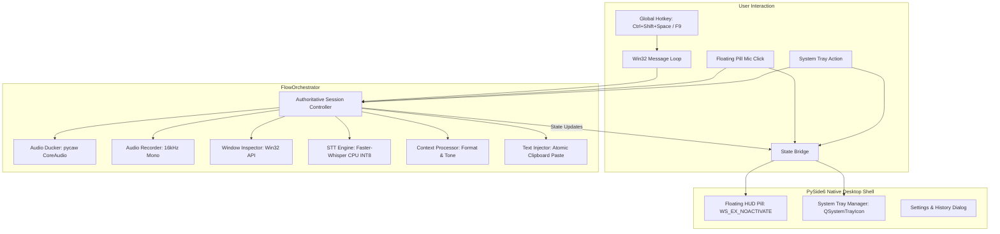
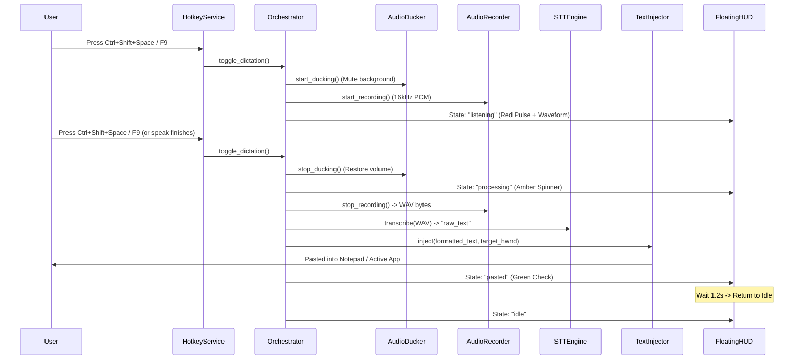

# FlowPilot Desktop Architecture & Cross-Platform Blueprint

## 1. System Architecture Overview

FlowPilot is designed as an event-driven, local-first voice intelligence desktop system. It provides instant, cross-application speech-to-text dictation with automatic background audio ducking, context-aware formatting, and active-window text injection.



---

## 2. Platform-Independent Abstraction Layer

To ensure future portability to macOS and Linux while maintaining native OS responsiveness, FlowPilot decouples OS-specific operations behind clean interfaces:

```
+-------------------------------------------------------------------+
|                        FlowOrchestrator                          |
+-------------------------------------------------------------------+
        |                    |                     |
        v                    v                     v
[HotkeyInterface]   [AudioCaptureInterface]  [TextInjectionInterface]
  - Win32RegisterHK    - SoundDevice/PortAudio   - Win32AttachThreadInput
  - macOS CGEventTap                             - macOS Accessibility AX
        |                    |                     |
        v                    v                     v
[AudioDuckerInterface] [WindowInspectorInterface] [FloatingHUD]
  - Win32 pycaw          - Win32 GetForegroundWindow - PySide6 Frameless
  - macOS CoreAudio      - macOS NSWorkspace          - Win: WS_EX_NOACTIVATE
                                                      - Mac: NSWindow.Level
```

### 2.1 Hotkey Service (`HotkeyInterface`)
* **Windows Implementation:**
  - `engine/hotkey_service.py` using `RegisterHotKey(hWnd, id, fsModifiers | MOD_NOREPEAT, vk)`.
  - Posts `WM_HOTKEY` to a dedicated message thread queue.
  - Kernel-level intercept eliminates hook timeouts (`LowLevelHooksTimeout`) and elevated process drops.
* **macOS Implementation Requirements:**
  - Requires **Quartz Event Taps** (`CGEventTapCreate`) or `NSEvent.addGlobalMonitorForEventsMatchingMask`.
  - Requires `NSAppleEventsUsageDescription` and macOS Accessibility Permissions (`AXIsProcessTrustedWithOptions`).
  - Alternatively, Carbon global hotkeys (`RegisterEventHotKey`).

### 2.2 Text Injection (`TextInjectionInterface`)
* **Windows Implementation:**
  - `engine/text_injector.py`
  - Captures foreground window HWND before recording.
  - Restores target focus via `win32process.AttachThreadInput` and `AllowSetForegroundWindow(-1)`.
  - Preserves user clipboard: copies text -> sends synthetic `Ctrl + V` via `win32api.keybd_event` -> restores previous clipboard after 300ms.
* **macOS Implementation Requirements:**
  - Direct Accessibility API: `AXUIElementCopyAttributeValue` with `kAXFocusedUIElementAttribute`, then `AXUIElementSetAttributeValue(focusedElem, kAXSelectedTextAttribute, text)`.
  - Fallback: AppleScript / `NSPasteboard` + simulated `Cmd + V` (`CGEventCreateKeyboardEvent`).

### 2.3 Floating HUD ("Flow Pill") Non-Activation (`FloatingHUDInterface`)
* **The Non-Activation Rule:**
  - If clicking the microphone button activates the HUD window, the user's active editor (e.g., Notepad, VS Code) loses focus.
  - Subsequent text paste would target the HUD itself instead of the document.
* **Windows Solution:**
  - Set Win32 extended style `WS_EX_NOACTIVATE (0x08000000)` and `WS_EX_TOPMOST (0x00000008)` via `SetWindowLongW`.
  - PySide6 window flags: `Qt.WindowStaysOnTopHint | Qt.FramelessWindowHint | Qt.Tool | Qt.WindowDoesNotAcceptFocus`.
* **macOS Solution:**
  - Set `NSWindow.level = .floating` or `.statusBar`.
  - Override `canBecomeKeyWindow` and `canBecomeMainWindow` to return `false`.
  - Set `collectionBehavior = [.canJoinAllSpaces, .stationary]`.

### 2.4 Audio Ducking (`AudioDuckerInterface`)
* **Windows Solution:**
  - `engine/audio_ducker.py` using `pycaw` and `comtypes.CoInitialize()`.
  - Iterates over all active audio sessions in `AudioUtilities.GetAllSessions()`.
  - Excludes own process PID; mutes or attenuates third-party media players (Spotify, Chrome, VLC).
  - Restores volume in `finally` blocks to guarantee audio is never left muted.
* **macOS Solution:**
  - Uses `AudioHardwareService` or `CoreAudio` HAL API to observe and adjust default output session or target application audio units.

---

## 3. Authoritative Session Lifecycle



---

## 4. Model Storage & Offline Inference Strategy

1. **Local Inference:**
   - Powered by `faster-whisper` (CTranslate2).
   - Local weights stored in standard user cache:
     - Windows: `C:\Users\<user>\.cache\huggingface\hub\models--Systran--faster-whisper-base`
     - macOS: `~/.cache/huggingface/hub/models--Systran--faster-whisper-base`
   - Weight files: `model.bin` (~145MB for `base`), `config.json`, `tokenizer.json`, `vocabulary.txt`.
2. **First-Run Behavior:**
   - On a clean system, `faster-whisper` checks the local cache. If missing, it downloads weights automatically over HTTPS from HuggingFace Hub.
   - For offline enterprise air-gapped deployments, pre-bundled weights can be placed directly in `<InstallDir>/models/`.
