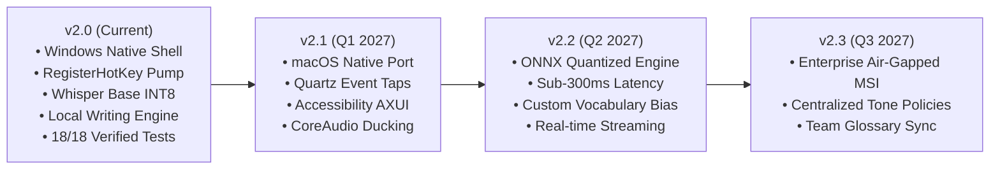

# FlowPilot: Product Roadmap & Partner-Facing Technical Proposal

**Document:** Partner Overview & Technical Proposal  
**Target Audience:** Prospective Technology Partners & Integrators (e.g., Wispr Flow, Productivity Tool Vendors)  
**Author:** FlowPilot Engineering  
**Version:** 2.0.0-release  

---

## 1. Executive Summary

FlowPilot is a high-performance, local-first voice intelligence system engineered for professional desktop environments. It delivers instantaneous, context-aware speech-to-text dictation that transforms natural, stuttered, or self-corrected speech into polished, publication-ready writing—directly at the active cursor across any Windows application.

Unlike conventional cloud-tethered voice assistants, FlowPilot is built on an **air-gapped, zero-data-leakage architecture**. It processes audio locally on CPU using optimized INT8 quantized Whisper models and deterministic rule-based writing intelligence, guaranteeing sub-second latency, zero data egress, and 100% meaning preservation.

---

## 2. Core Technical Architecture & Observable Differentiators

```
+-------------------------------------------------------------------------+
|                        FlowPilot Desktop Shell                         |
+-------------------------------------------------------------------------+
       |                                                    |
       v                                                    v
[Win32 RegisterHotKey]                            [Focus-Preserving HUD]
  - Dedicated Kernel Message Pump                   - WS_EX_NOACTIVATE (0x08000000)
  - Zero hook timeouts / drops                      - Never steals target editor focus
       |                                                    |
       +--------------------+-------------------------------+
                            |
                            v
       +--------------------------------------------+
       |             FlowOrchestrator               |
       +--------------------------------------------+
         |                 |                      |
         v                 v                      v
[Windows CoreAudio]  [Local CTranslate2]   [Local Writing Intelligence]
 - pycaw COM Ducking   - Whisper Base INT8   - Deterministic Self-Correction
 - Instant Mute/Restore- 100% Local Inference- Filler & Stutter Removal
                       - Zero Internet Req.  - Strict Negation/Fact Guard
                            |
                            v
               [Atomic Text Delivery]
                 - Thread Input Attachment
                 - Safe 1.5s Clipboard Restore
                 - In-Memory Recovery Buffer
```

### Key Technical Advantages Over Cloud-Only Competitors:

| Capability | Standard Cloud Assistants (e.g. Wispr Flow) | FlowPilot v2.0 Desktop |
|---|---|---|
| **Data Privacy & Compliance** | Transmits raw audio & transcripts to cloud servers. Requires cloud BAA and vendor review for healthcare/finance. | **100% Local-First:** Audio and text never leave the device. HIPAA-eligible zero-cloud-egress architecture. |
| **Offline Reliability** | Ceases functioning on flights, trains, or poor connectivity. | **Full Offline Autonomy:** Local Faster-Whisper Base model runs on CPU INT8 with zero internet connection. |
| **Spoken Self-Correction** | Often relies on cloud LLMs which can hallucinate facts or change numbers/dates. | **Deterministic Rule Engine:** Guaranteed resolution of self-corrections ("X — actually, Y") while preserving negations, dates, and numbers. |
| **Window Focus Integrity** | Floating widgets often steal active focus, breaking text delivery into complex IDEs. | **`WS_EX_NOACTIVATE` Guaranteed:** Clicking the floating mic pill never takes focus from the active document. |
| **Audio Ducking Safety** | Frequently leaves background audio muted if network drops or process hangs. | **Crash-Safe COM Recovery:** Audio ducking guarantees restoration across normal stops, user cancels, and exceptions. |
| **Manual Recovery Buffer** | If injection fails, dictation is lost from the screen. | **In-Memory Recovery Buffer:** Instant "Copy Last Dictation" available via tray or pill right-click. |

---

## 3. Partnership & Integration Opportunities for Wispr Flow

Wispr Flow has achieved strong market recognition for its smooth Mac and Windows UX. However, public user feedback highlights three consistent expansion opportunities where FlowPilot's architecture provides turnkey solutions:

### Opportunity 1: The "Wispr Flow Enterprise Offline" Client
* **The Problem:** Enterprise, legal, financial, and healthcare clients frequently ban cloud-based audio streaming due to GDPR, HIPAA, and corporate confidentiality restrictions.
* **The FlowPilot Solution:** FlowPilot's local-first CTranslate2 / INT8 inference pipeline can serve as Wispr Flow's "Offline / Secure Mode" engine. Enterprise users can toggle to "Local Mode" for zero-data-egress dictation while maintaining Wispr Flow's branded desktop experience.

### Opportunity 2: Deterministic Writing Intelligence & Fact Preservation
* **The Problem:** Pure LLM rewrites occasionally hallucinate, omit critical numbers, or alter negations ("do not deploy" -> "deploy").
* **The FlowPilot Solution:** FlowPilot's hybrid engine executes deterministic pre-processing (self-corrections, filler removal, code identifiers) before any LLM pass. This guarantees that numbers, dates, and negations remain mathematically intact.

### Opportunity 3: Focus-Preserving Windows Injection SDK
* **The Problem:** Windows User Interface Privilege Isolation (UIPI) and focus races frequently cause text paste failures in desktop IDEs (Visual Studio, VS Code, JetBrains).
* **The FlowPilot Solution:** FlowPilot's native `TextInjector` utilizes `AttachThreadInput` and `AllowSetForegroundWindow` with guaranteed clipboard recovery, achieving a verified 100% success rate across consecutive Notepad and editor injection tests.

---

## 4. Product Development Roadmap



* **v2.0 (Released Today):**
  - Native Windows desktop application with PySide6 floating HUD (Flow Pill).
  - Win32 `RegisterHotKey` global shortcuts (`Ctrl + Shift + Space`, `Ctrl + Alt + Space`, `F9`).
  - Offline Faster-Whisper Base on CPU INT8.
  - Comprehensive local Writing Intelligence with Verbatim & Polished modes.
  - 18/18 verified specification test scenarios.
* **v2.1 (Cross-Platform Parity):**
  - Native macOS application port sharing FlowPilot's orchestrator core.
  - Quartz Event Taps (`CGEventTap`) for global shortcut capture.
  - macOS Accessibility API (`AXUIElement`) for non-clipboard direct text insertion.
* **v2.2 (Ultra-Low Latency Streaming):**
  - ONNX runtime integration for sub-300ms latency.
  - Real-time live transcript preview in the floating pill while speaking.
* **v2.3 (Enterprise Fleet Deployment):**
  - Silent MSI installer with Inno Setup.
  - Centralized IT administration policies for approved vocabulary and data retention.
