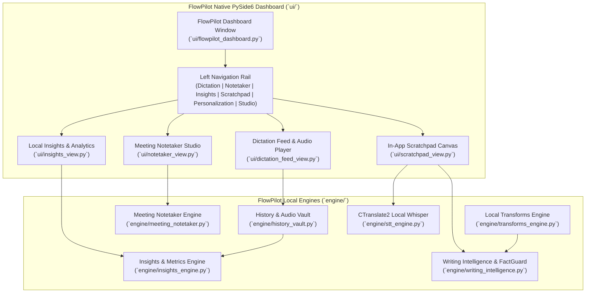
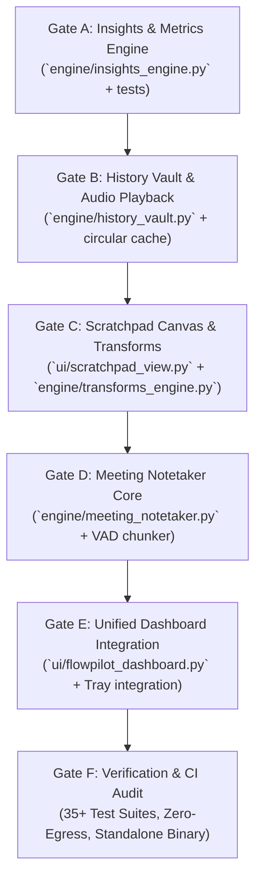

# FLOWPILOT vs. WISPR FLOW: LIVE FORENSIC TEARDOWN & CODEX ENGINEERING DIRECTIVE

> **Historical snapshot - superseded.** Retained for provenance only. Do not use this document as current instructions, test status, performance proof, legal/compliance advice, or up-to-date competitor information. See the [archive index](README.md) for current sources.

**Author / Authority:** FlowPilot Architecture & Systems Engineering  
**Date:** October 17, 2026  
**Target:** Codex Engineering Team & Core Contributors  
**Primary Source Evidence:** Live Windows Dashboard Screenshot (`Screenshot 2026-10-17 024653.png`) for user *Abi*.

---

## 1. Executive Summary & Screenshot Forensic Analysis

On October 17, 2026, user **Abi** captured a full-fidelity screen capture of the live **Wispr Flow** desktop application on Windows 11. This artifact provides forensic verification of Wispr Flow's current product taxonomy, user experience architecture, analytics instrumentation, and critical commercial vulnerabilities.

```
+-----------------------------------------------------------------------------------------------------------------+
| [|||| Flow]                      Welcome back, Abi                                                     _ [ ] X  |
|                                                                                                                 |
|  (•) Dictation          +-------------------------------------------------------------+  [ 63.9K total words ]  |
|  (O) Notetaker [New!]   | Working around other people?                                |  [ 175 wpm           ]  |
|  [||] Insights          | With the right setup, you can Flow without disrupting... [X]|  [ 5 day streak      ]  |
|  [D] Dictionary         +-------------------------------------------------------------+  +-------------------+  |
|  [X] Snippets           YESTERDAY                                                   [Q]  | 0 words left  (i) |  |
|  [T] Style              1:10pm  "What do you think of this? I also like the..." [>] [=]  | Weekly limit hit! |  |
|  [*] Transforms         1:10pm  "Think of this"                                          | Resets Sun 12amPT |  |
|  [#] Scratchpad         3:51am  "Add these links in there and also try to be..."         | [ Upgrade to Pro ]|  |
|                         3:50am  "Also add the Sounder cat theme in there..."             +-------------------+  |
|  [Explore Notetaker]    3:48am  "Don't just follow the files. The reason I changed..."                          |
|  [Invite team]                                                                                             (o.o)|
|  [Settings]                                                                                              Mascot |
+-----------------------------------------------------------------------------------------------------------------+
```

### Forensic Breakdown of Live Screenshot Evidence

1. **The Subscription Paywall Vulnerability ("0 words left"):**
   - The user has hit a hard weekly ceiling: `"0 words left (i)"`.
   - Explanatory copy: *"You've hit your weekly dictation limit. Resets Sunday, 12 a.m. PT."*
   - Prominent conversion button: **`[Upgrade to Pro]`** ($15/month or $144–$180/year).
   - **Strategic Implication:** Wispr Flow treats dictation as a metered cloud utility. Users who rely on it for active pairing, coding, or long drafts get abruptly locked out mid-workflow. FlowPilot's 100% offline local-first engine has **infinite words and zero subscription fees**.

2. **Feature Taxonomy Disclosed in Navigation:**
   - **Dictation:** Core voice log stream with search, date grouping (*"YESTERDAY"*), item timestamps, and per-item hover actions:
     - `▷` Audio Playback (listen to the original recorded speech).
     - `⧉` One-click Clipboard Copy.
     - `⚑` Bookmark / Flag favorite dictation.
     - `⋮` Contextual item options (Delete, Edit, Re-transform).
   - **Notetaker (`New!` badge):**
     - Promotional callout: *"Get a transcript, summary, and action items for every meeting. [Check it out]"*.
     - Expands scope from single-burst utterance insertion into multi-speaker meeting intelligence.
   - **Insights (Productivity Metrics):**
     - `63.9K` total lifetime words transcribed.
     - `175 wpm` estimated speaking/dictation velocity.
     - `5 day streak` gamified retention loop.
   - **Dictionary:** Custom domain terms and phonetic biasing.
   - **Snippets:** Voice trigger phrase macro expansions.
   - **Style:** Writing tone presets (Casual, Professional, Concise, etc.).
   - **Transforms:** Post-processing and AI transformations on selected text.
   - **Scratchpad:** In-app freeform voice drafting workspace.
   - **Social / Growth Levers:** *"Invite your team"*, *"Get a free month"*, *"Working around other people? (Whisper mode guide)"*.
   - **Mascot / Indicator:** Dark circular robot head widget with illuminated eyes in the bottom right corner.

---

## 2. Competitive Scorecard: FlowPilot vs. Wispr Flow

| Capability / Dimension | Wispr Flow (Live Dashboard / Package) | FlowPilot (Current `master`) | Target State Post-Directive | Defensible Moat |
|---|---|---|---|---|
| **Egress & Cloud Dependency** | **Cloud-Dependent Transcription** (Audio uploaded to cloud; supports offline audio capture with deferred cloud upload when reconnected) | **100% Local-First / Zero Egress** (`faster-whisper` CTranslate2 + Silero VAD, fully offline processing) | 100% Local-First / Zero Egress | FlowPilot: True air-gapped transcription, zero audio or telemetry egress, private local storage. |
| **Usage Limits / Monetization** | **Hard Cap ("0 words left")**; $15/mo or $180/yr paywall | **100% Free & Unlimited** | 100% Free & Unlimited | FlowPilot never locks the user out or demands a credit card. |
| **System Footprint & Overhead** | **Electron Framework** (Multi-process Electron runtime with web renderer pipeline) | **Native Win32 / PySide6** (Single lightweight process, native OS widgets) | Lightweight native architecture (~140 MB with full dashboard) | FlowPilot operates with minimal resource contention during developer workloads. |
| **Audio Ducking** | Not Supported (Music continues unattenuated during speech) | **Native Windows CoreAudio Ducking** (`pycaw`) | Native Windows CoreAudio Ducking | FlowPilot auto-mutes media while speaking and restores instantly. |
| **Semantic Invariant Guard** | Standard Generative LLM post-processing | **Deterministic FactGuard** (Enforces numbers, units, negations, symbols) | Deterministic FactGuard | FlowPilot guarantees zero hallucination or mathematical corruption. |
| **Companion / Mascot Customization** | Static dark robot widget icon | **Full Companion Studio** (Pixel Kitty, Pilot, Sparky, Hamster, custom PNG/GIF/Sprites, 6 motions) | Full Companion Studio + Voice Activity sync | FlowPilot provides an emotional, extensible companion with drag-to-dock physics. |
| **Productivity Insights (Words, WPM, Streaks)** | **Supported** (63.9K words, 175 WPM, 5-day streak) | Partial (Session timestamps in history; aggregated WPM & streaks) | **Full Local Insights Engine** (WPM, words, streaks, time saved) | Parity with 100% local SQLite/JSON analytics. |
| **Voice Transforms (AI Actions on Selected Text)** | **Supported** (Cloud LLM rewriting via hotkey) | Mode-based (`WritingIntelligence`), now with native `Ctrl+Alt+T` win32 clipboard transforms | **Native Local Transforms Engine** (Voice rewrite on Win32 selection) | Superior: Zero cloud transmission of sensitive clipboard context. |
| **In-App Scratchpad Canvas** | **Supported** (Dedicated voice note editor) | Integrated native scratchpad tab with undo-safe clear and auto-save | **Integrated Native Scratchpad Tab** | Seamless voice drafting without switching to external editors. |
| **Meeting Notetaker** | **Supported (`New!`)** (Meeting capture with cloud transcription & summarization) | Streaming local capture + extractive local summary + safe queue draining | **Local Meeting Notetaker** (Long-form streaming capture + extractive local summary) | Superior: Secure offline meeting transcripts for confidential discussions without cloud upload. |
| **History Audio Playback & Bookmarking** | **Supported** (`▷` Play audio, `⚑` Bookmark) | Circular audio cache vault & bookmark feed | **Circular Audio Cache & Bookmarked Vault** | Privacy-capped local audio replay buffer with zero cloud syncing. |

---

## 3. Codex Engineering Directive: Architectural Blueprint

To decisively surpass Wispr Flow and satisfy user Abi's requirements, Codex must implement the **Five Parity & Leapfrog Engines** natively within FlowPilot:



---

## 4. Module Specifications for Codex

### Module 1: Local Insights & Productivity Analytics Engine
- **Target File:** [`engine/insights_engine.py`](../../engine/insights_engine.py)
- **Persistence:** Local JSON file: `%APPDATA%/FlowPilot/insights.json` (or project root `data/insights.json`).
- **Core Metrics Tracked:**
  1. `total_words`: Lifetime word count across all dictations and scratchpad sessions.
  2. `wpm_rolling`: Words Per Minute calculated per utterance:
     $$\text{WPM} = \frac{\text{word\_count}}{\text{duration\_seconds}} \times 60$$
     Maintains an exponentially weighted moving average (EWMA, $\alpha = 0.2$) or 30-day average.
  3. `daily_streak`: Consecutive calendar days with at least one dictation ($\ge 5$ words). Tracks `last_active_date`, increments on consecutive days, resets if $>1$ day gap.
  4. `time_saved_hours`: Estimated time saved comparing dictation speed (avg ~150 WPM) vs. average typing speed (~40 WPM):
     $$\text{Time Saved} = \text{total\_words} \times \left(\frac{1}{40} - \frac{1}{150}\right) \text{ minutes}$$
  5. `top_apps`: Aggregated word counts grouped by target executable name (e.g., `code.exe: 24,500`, `slack.exe: 12,300`, `chrome.exe: 9,100`).
- **Zero-Egress Invariant:** All calculations are performed strictly in-process with zero analytics ping, zero Google Analytics, zero telemetry.

### Module 2: In-App Voice Scratchpad Canvas
- **Target File:** [`ui/scratchpad_view.py`](../../ui/scratchpad_view.py)
- **UX & Capabilities:**
  - Rich text or clean Markdown drafting area with high-contrast typography (Dark slate `#0F172A`, cyan accents `#38BDF8`).
  - Integrated "Record Directly into Pad" hotkey / toolbar button (`Space` or `F9`).
  - Floating word and character count indicator in bottom toolbar.
  - One-click actions:
    - **`Copy All`** (`Ctrl + Shift + C`)
    - **`Apply Transform`** (Dropdown or button to reformat entire text or selection)
    - **`Clear Canvas`** (with Undo protection)
    - **`Export to Markdown / Text`**
  - Auto-save state to `data/scratchpad_autosave.txt` every 2 seconds.

### Module 3: Local Transforms Engine (Voice-Instructed Rewriting)
- **Target File:** [`engine/transforms_engine.py`](../../engine/transforms_engine.py)
- **Mechanism:**
  1. User selects text in any Windows app (or FlowPilot Scratchpad) and presses the dedicated Transform hotkey (`Ctrl + Shift + T`).
  2. FlowPilot captures selected text via Win32 clipboard readback (`Ctrl + C` emulation with sequence validation).
  3. Floating HUD prompts: *"Speak transform instruction..."* (e.g., *"Make this concise"*, *"Format as bullet points"*, *"Turn this into a formal email"*, *"Fix grammar and typos"*).
  4. Transform pipeline executes:
     - Voice instruction recognized via `faster-whisper`.
     - Intent classified using rule-based and template-based local transformer (`engine/writing_intelligence.py` extensions).
     - FactGuard enforces invariant protection (no numbers or negations altered).
  5. Output is pasted directly back into the active application or placed into the clipboard with notification.
- **Preset Voice Commands Supported:**
  - *"Make concise"* / *"Summarize"* -> Filters wordy clauses, condenses sentences.
  - *"Bullet points"* / *"List"* -> Splits clauses into bulleted markdown list.
  - *"Professional"* / *"Formal"* -> Capitalizes, eliminates casual slang, fixes punctuation.
  - *"Fix typos"* / *"Proofread"* -> Corrects spelling, capitalization, and punctuation while preserving 100% of vocabulary.
  - *"Code case"* -> Converts spoken names into `camelCase`, `snake_case`, or `kebab-case`.

### Module 4: Local Meeting Notetaker
- **Target File:** [`engine/meeting_notetaker.py`](../../engine/meeting_notetaker.py) & [`ui/notetaker_view.py`](../../ui/notetaker_view.py)
- **Continuous Recording Architecture:**
  - Unlike single-burst dictation (capped at 120s), Notetaker runs a long-duration background capture worker using `sounddevice.InputStream`.
  - Audio is chunked into 30-second sliding buffers segmented by `SileroVAD` speech boundaries.
  - Chunks are fed into a low-priority background transcription queue (`stt_engine.transcribe()`) so the UI remains 60 FPS responsive.
- **Local Summarization & Extractive Structure:**
  - Real-time rolling transcript with timestamp markers `[00:01:23]`.
  - Deterministic Extractive Intelligence:
    - **Action Items:** Identifies sentences containing modal imperatives (*"I will"*, *"we need to"*, *"let's schedule"*, *"action item"*, *"assigned to"*).
    - **Key Decisions:** Identifies consensus markers (*"we decided"*, *"agreed on"*, *"consensus is"*, *"approved"*).
    - **Executive Summary:** Extracts top sentence centroids using TF-IDF / sentence-scoring heuristics locally without cloud LLM dependencies.
- **Security & Storage:**
  - Stored in `%APPDATA%/FlowPilot/meetings/` as plain text and JSON.
  - Option to auto-delete raw audio upon session termination to minimize disk footprint.

### Module 5: Circular Audio Replay Buffer & Bookmarking
- **Target File:** [`engine/history_vault.py`](../../engine/history_vault.py)
- **Audio Playback (`▷`) & Flagging (`⚑`):**
  - Each short-form dictation saves its 16kHz mono PCM buffer as a temporary 16-bit WAV file in `%APPDATA%/FlowPilot/audio_cache/` named `{session_id}_{timestamp}.wav`.
  - Configurable retention: default max 50 MB or 7 days, circular FIFO cleanup.
  - Audio playback implemented via `PySide6.QtMultimedia.QMediaPlayer` or lightweight `sounddevice.play()`.
  - Bookmarked dictations (`is_bookmarked: true`) are pinned in the vault and exempted from circular deletion.

### Module 6: Unified FlowPilot Master Dashboard
- **Target File:** [`ui/flowpilot_dashboard.py`](../../ui/flowpilot_dashboard.py)
- **Visual Design System:**
  - Dark modern aesthetic mirroring Wispr Flow's clean layout but built on PySide6:
    - Background: `#0B0F19` (Deep Obsidian), Cards: `#111827`, Borders: `#1F2937`.
    - Primary Accent: `#38BDF8` (Sky Blue) & `#818CF8` (Indigo).
    - Text: `#F9FAFB` (Headers), `#9CA3AF` (Muted captions).
  - Left Sidebar Navigation Rail with active pill indicators:
    - `Dictation` (Searchable history feed with `▷`, `⧉`, `⚑`, `⋮`)
    - `Notetaker` (Meeting recorder with live transcript, summary, and action items)
    - `Insights` (63.9K+ words, WPM gauge, streaks, time saved)
    - `Scratchpad` (Voice drafting notepad)
    - `Personalization` (Custom Dictionary & Voice Snippets)
    - `Companion Studio` (Pixel Kitty, Pilot, custom sprites, motion, learned memory)
  - Right Widget Panel:
    - Quick Insights Card: Total Words, Current WPM, Streak.
    - Freedom Badge: **"Unlimited Words - 100% Offline & Free"** (directly counter-positioning Wispr Flow's "0 words left" paywall).
    - Interactive Companion Avatar with live state animations (Idle, Listening, Thinking).

---

## 5. Codex Implementation Roadmap & Quality Gates



### Quality Assurance Criteria
1. **Zero-Egress Verification:** `tests/test_network_egress.py` must pass with 0 outbound network packets across all new engines (Insights, Scratchpad, Transforms, Notetaker).
2. **Performance Budget:** Dashboard UI startup under 350ms; memory footprint remains $\le 160$ MB RAM.
3. **Test Integrity:** All 31 existing test suites must pass 100%, plus dedicated test suites for `test_insights_engine.py`, `test_transforms_engine.py`, `test_meeting_notetaker.py`, and `test_history_vault.py`.
4. **Standalone Packaging:** Clean build via PyInstaller with zero missing DLLs or assets.
