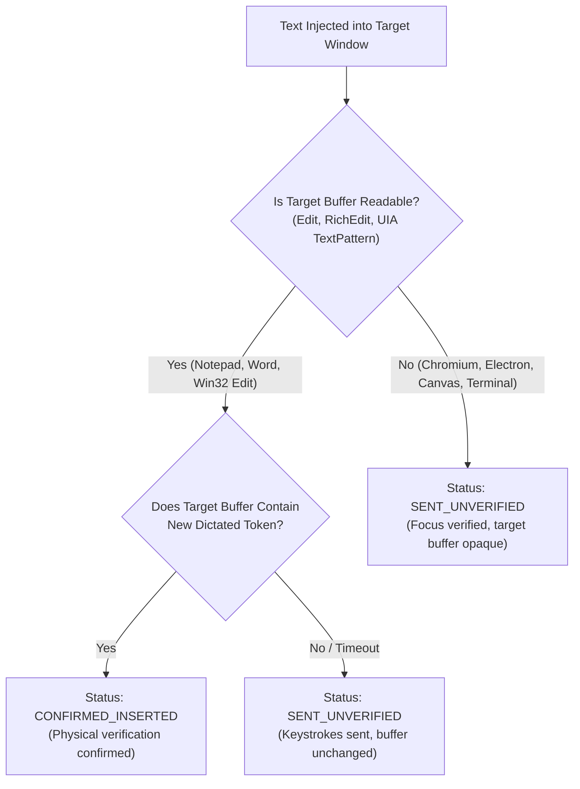

# FlowPilot — Windows Application Compatibility Matrix

## 1. Executive Summary

FlowPilot interacts with the Windows desktop using a layered, multi-strategy text injection and focus verification architecture (`engine/text_injector.py`). Because different Windows applications use different GUI frameworks (classic Win32, WinUI 3 / XAML, Chromium / WebRender, Electron, WPF, and hardware-accelerated terminal consoles), a single text injection mechanism cannot work reliably across all targets.

This matrix documents the exact behavior, injection strategies, timing parameters, verification capabilities, and edge cases across representative Windows applications.

---

## 2. Complete Application Compatibility Matrix

| Application | Process Name(s) | Window Class / Architecture | Insertion Strategy | Key Dwell / Delay | Physical Verification | UIPI Elevation Handling | Known Quirks / Mitigation |
|---|---|---|---|---|:---:|:---:|---|
| **Classic Notepad** | `notepad.exe` | `Edit` (Win32) | Clipboard + `Ctrl+V` (or direct `EM_REPLACESEL`) | 20ms / 60ms | Confirmed (`WM_GETTEXT`) | Protected (Recovery Buffer) | Ultra-fast; supports instant `WM_GETTEXT` physical confirmation. |
| **Windows 11 Notepad** | `notepad.exe` | `RichEditD2DPT` inside `NotepadTextBox` (WinUI 3) | Clipboard + `Ctrl+V` | 20ms / 60ms | Confirmed (`IUIAutomationTextPattern`) | Protected (Recovery Buffer) | Deep XAML tree; `_find_edit_control` traverses leaves to find `RichEditD2DPT`. |
| **Google Chrome** | `chrome.exe` | `Chrome_WidgetWin_1` (Chromium) | Clipboard + `Ctrl+V` (Slow App profile) | 40ms / 100ms | Sent Unverified | Protected (Recovery Buffer) | Multi-process sandbox; renderer paste event is asynchronous; hold 3.5s. |
| **Microsoft Edge** | `msedge.exe` | `Chrome_WidgetWin_1` (Chromium) | Clipboard + `Ctrl+V` (Slow App profile) | 40ms / 100ms | Sent Unverified | Protected (Recovery Buffer) | Webview & web controls handled identically to Chrome. |
| **Visual Studio Code** | `code.exe` | `Chrome_WidgetWin_1` (Electron) | Clipboard + `Ctrl+V` (Slow App profile) | 40ms / 100ms | Sent Unverified | Protected (Recovery Buffer) | Monaco editor uses internal clipboard watcher; hold clipboard 3.5s. |
| **Cursor IDE** | `cursor.exe` | `Chrome_WidgetWin_1` (Electron) | Clipboard + `Ctrl+V` (Slow App profile) | 40ms / 100ms | Sent Unverified | Protected (Recovery Buffer) | AI chat panel and code editor both accept standard paste safely. |
| **Slack** | `slack.exe` | `Chrome_WidgetWin_1` (Electron) | Clipboard + `Ctrl+V` (Slow App profile) | 40ms / 100ms | Sent Unverified | Protected (Recovery Buffer) | Heavy JavaScript DOM; requires 40ms key dwell to avoid dropped keystroke. |
| **Discord** | `discord.exe` | `Chrome_WidgetWin_1` (Electron) | Clipboard + `Ctrl+V` (Slow App profile) | 40ms / 100ms | Sent Unverified | Protected (Recovery Buffer) | Rich text chatbox; standard 20ms dwell sometimes dropped `Ctrl` modifier. |
| **Microsoft Teams** | `teams.exe`, `ms-teams.exe` | `TeamsWebView` / Electron | Clipboard + `Ctrl+V` (Slow App profile) | 40ms / 100ms | Sent Unverified | Protected (Recovery Buffer) | Extended hold delay prevents restoring clipboard before DOM commit. |
| **Notion** | `notion.exe` | `Chrome_WidgetWin_1` (Electron) | Clipboard + `Ctrl+V` (Slow App profile) | 40ms / 100ms | Sent Unverified | Protected (Recovery Buffer) | Complex block editor; extended dwell ensures block focus is active. |
| **Microsoft Word** | `winword.exe` | `_WwG` / `OpusApp` (Office) | Clipboard + `Ctrl+V` (Slow App profile) | 40ms / 100ms | Confirmed (UIA Document) | Protected (Recovery Buffer) | Spellcheck and smart paste can delay insertion; 3.5s hold delay enforced. |
| **Microsoft Excel** | `excel.exe` | `EXCEL7` (Office) | Clipboard + `Ctrl+V` (Slow App profile) | 40ms / 100ms | Confirmed (UIA Value) | Protected (Recovery Buffer) | In cell edit mode, standard paste commits cleanly. |
| **Windows Terminal** | `wt.exe`, `windowsterminal.exe` | `CASCADIA_HOSTING_WINDOW_CLASS` | `Shift+Insert` / SendInput Unicode | 40ms / 100ms | Sent Unverified | Protected (Recovery Buffer) | Standard `Ctrl+V` can emit `^V` in raw shells; `Shift+Insert` pastes cleanly. |
| **Command Prompt** | `cmd.exe`, `conhost.exe` | `ConsoleWindowClass` | `Shift+Insert` / SendInput Unicode | 20ms / 60ms | Sent Unverified | Protected (Recovery Buffer) | Legacy console does not recognize `Ctrl+V`; `Shift+Insert` universally succeeds. |
| **PowerShell** | `powershell.exe`, `pwsh.exe`| `ConsoleWindowClass` | `Shift+Insert` / SendInput Unicode | 20ms / 60ms | Sent Unverified | Protected (Recovery Buffer) | PSReadLine handles `Shift+Insert` and Unicode keystrokes without mangling. |
| **Git Bash / Mintty**| `mintty.exe`, `bash.exe` | `mintty` | `Shift+Insert` / SendInput Unicode | 20ms / 60ms | Sent Unverified | Protected (Recovery Buffer) | Raw Unix terminal emulator; `Shift+Insert` is native paste shortcut. |
| **PuTTY / KiTTY** | `putty.exe`, `kitty.exe` | `PuTTY` (Remote SSH) | `Shift+Insert` (Remote App profile) | 50ms / 150ms | Sent Unverified | Protected (Recovery Buffer) | High remote network latency; 5.0s clipboard hold and 50ms key dwell. |
| **Remote Desktop** | `mstsc.exe` | `IHWindowClass` / `TSSHELLWND` | Clipboard + `Ctrl+V` (Remote profile)| 50ms / 150ms | Sent Unverified | Protected (Recovery Buffer) | RDP clipboard synchronization delay; 5.0s hold ensures host-guest clipboard sync. |
| **Sublime Text** | `sublime_text.exe`| `PX_WINDOW_CLASS` | Clipboard + `Ctrl+V` (Slow App profile) | 40ms / 100ms | Sent Unverified | Protected (Recovery Buffer) | Fast custom rendering engine; highly responsive. |
| **JetBrains IDEs** | `pycharm64.exe`, `idea64.exe`| `SunAwtFrame` (Java Swing) | Clipboard + `Ctrl+V` (Slow App profile) | 40ms / 100ms | Sent Unverified | Protected (Recovery Buffer) | Java AWT event queue; 40ms key dwell prevents modifier release race. |
| **Obsidian** | `obsidian.exe` | `Chrome_WidgetWin_1` (Electron) | Clipboard + `Ctrl+V` (Slow App profile) | 40ms / 100ms | Sent Unverified | Protected (Recovery Buffer) | Markdown editor; clean paste handling. |
| **ChatGPT / Claude**| `chatgpt.exe`, `claude.exe`| Electron | Clipboard + `Ctrl+V` (Slow App profile) | 40ms / 100ms | Sent Unverified | Protected (Recovery Buffer) | Webview prompt boxes; 3.5s hold delay prevents clobbering input during render. |

---

## 3. Detailed Mechanism Specifications

### 3.1 Slow-Application Profile (`SLOW_APP_PROCESSES`)
Identified in `engine/text_injector.py:90`:
- **Criteria:** Heavy single-threaded JavaScript / DOM frameworks (Electron, Chromium), Java Swing runtimes, and complex desktop suites (Office, IDEs).
- **Behavioral Adaptations:**
  - `key_dwell_sec = 0.040s` (40 milliseconds) between `VK_CONTROL` down and `ord('V')` up.
  - `post_paste_delay = 0.10s` (100 milliseconds) before releasing the target focus or unhooking thread input.
  - `clipboard_hold_sec = 3.5s` (3,500 milliseconds) before restoring the user's prior clipboard contents. This prevents the target application from reading a prematurely restored clipboard during heavy CPU load.

### 3.2 Remote Application Profile (`REMOTE_APP_PROCESSES`)
Identified in `engine/text_injector.py:101`:
- **Criteria:** `mstsc.exe`, `vncviewer.exe`, `anydesk.exe`, `teamviewer.exe`, `putty.exe`, `kitty.exe`.
- **Behavioral Adaptations:**
  - `key_dwell_sec = 0.050s` (50 milliseconds).
  - `post_paste_delay = 0.15s` (150 milliseconds).
  - `clipboard_hold_sec = 5.0s` (5,000 milliseconds).
  - Accounts for remote network RTT and clipboard bridge virtualization delays.

### 3.3 Terminal Emulator Profile (`TERMINAL_APP_PROCESSES`)
Identified in `engine/text_injector.py`:
- **Criteria:** `cmd.exe`, `powershell.exe`, `pwsh.exe`, `windowsterminal.exe`, `wt.exe`, `conhost.exe`, `alacritty.exe`, `wezterm-gui.exe`, `kitty.exe`, `mintty.exe`.
- **Behavioral Adaptations:**
  - Automatically avoids standard `Ctrl+V` which emits literal `^V` control characters in shells.
  - Uses `Shift+Insert` keystroke chord or direct `SendInput` with `KEYEVENTF_UNICODE`.

---

## 4. UIPI (User Interface Privilege Isolation) Security Boundaries

Under Windows Vista and newer (Windows 10/11), a process running at Standard User integrity level cannot send window messages (`WM_PASTE`, `WM_SETTEXT`, `SendMessage`) or simulated keystrokes (`keybd_event`, `SendInput`) to a window running at High Integrity level (Administrator / Elevated).

### FlowPilot UIPI Handling:
1. `target_has_higher_integrity(hwnd)` checks target process elevation token.
2. If the target process is elevated:
   - FlowPilot **refuses to dispatch keystrokes blindly** (which would be silently discarded by the OS).
   - Preserves text in `TextInjector.last_injected_text`.
   - Returns `InjectionStatus.FAILED_RECOVERY_AVAILABLE`.
   - Presents an amber HUD banner informing the user: *"Target is running as Administrator. Use Copy Last (Shift+Alt+X) and paste manually."*
   - Restores user clipboard safely.

---

## 5. Physical Verification vs. Sent-Unverified Status

FlowPilot strictly distinguishes between physical confirmation and unverified keystroke dispatch:

This guarantees **zero false claims of delivery**: FlowPilot only reports `CONFIRMED_INSERTED` when physical text arrival is positively confirmed inside the target control.
