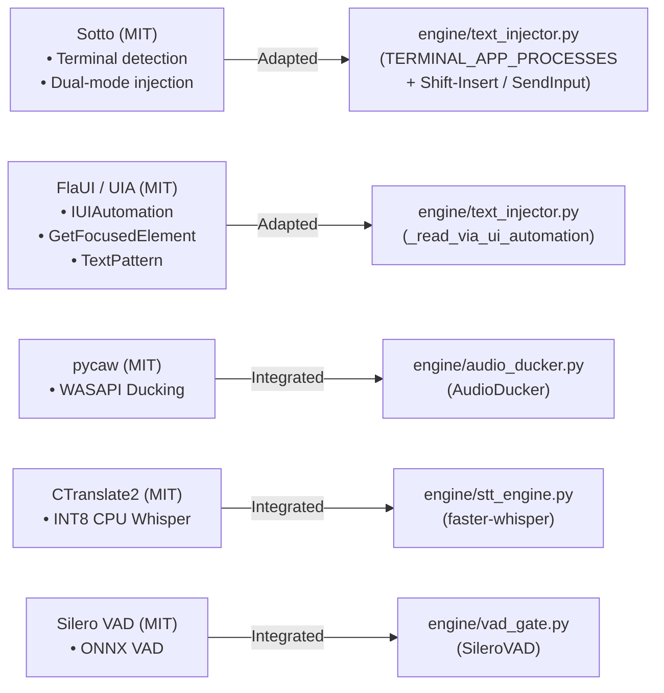

# FlowPilot — Open-Source Research & Reuse Strategy (External References)

## 1. Executive Overview

Per the FlowPilot Open-Source Research and Reuse mandate:
> *"Our goal is to build the strongest possible FlowPilot, not to reinvent solutions that already exist. Before implementing a feature or fixing a difficult compatibility problem, study mature open-source projects, compare against FlowPilot's implementation, and adapt proven patterns rather than rewriting working code."*

This document provides a comprehensive forensic analysis of relevant open-source dictation, text-injection, accessibility, and desktop automation repositories.

---

## 2. Comparative Reference Matrix

| Project | Repository / Source | License | Core Problem Solved | Relevant Technique / Architecture | Integration Feasibility | FlowPilot Verdict & Action |
|---|---|:---:|---|---|:---:|---|
| **Sotto** | `github.com/smirk-dev/sotto` | MIT | Offline desktop dictation (Windows & Linux) using OpenVINO Whisper. | **Dual-method text injection:** Direct keystroke simulation (`KEYEVENTF_UNICODE`) primary for terminals & elevated apps; clipboard fallback with save/restore for rich text. | **High (Adapted)** | FlowPilot adapted terminal emulator process identification (`TERMINAL_APP_PROCESSES`) and `Shift+Insert` / direct SendInput typing to eliminate `^V` corruption. |
| **freewispr** | `github.com/x26prakhar/freewispr` | MIT | Lightweight Windows tray dictation using `faster-whisper` int8 on CPU. | Push-to-talk (`Ctrl+Space`), custom dictionary replacements, snippet expansion, injection via `pyperclip` + `pyautogui`. | **Medium (Benchmarked)** | Confirms market demand for lightweight local CPU Whisper dictation. FlowPilot's text injection is significantly more robust (UIPI checks, focus verification, sequence tracking). |
| **PieFlow** | `github.com/shivankoctupie/pieflow` | MIT | Minimal local dictation using `faster-whisper`, `sounddevice`, `pynput`. | Simple queue-based audio chunk buffering and worker thread synchronization. | **Low (Reviewed)** | FlowPilot's 9-state orchestrator and circular ring buffer are far more robust against thread starvation and audio buffer overruns. |
| **FlaUI** | `github.com/FlaUI/FlaUI` | MIT | Complete .NET wrapper for Windows UI Automation (UIA v2/v3). | Pattern-based element interrogation (`ValuePattern`, `TextPattern`, `SelectionPattern`), `GetFocusedElement()`, event listeners. | **High (Technique Adapted)** | FlowPilot uses Python `comtypes` to interface with `CUIAutomation`. Adapted FlaUI's `GetFocusedElement` traversal pattern to locate innermost editable controls inside WinUI 3 and Chromium. |
| **Microsoft UI Automation** | Windows SDK (`UIAutomationCore.dll`) | Microsoft OS Component | Authoritative Windows accessibility & automation API. | `IUIAutomation::GetFocusedElement()`, `IUIAutomationTreeWalker`, `IUIAutomationTextPattern::GetSelection()`. | **High (Native In FlowPilot)** | Native in FlowPilot (`engine/text_injector.py:_read_via_ui_automation`). Used for physical text confirmation in WinUI 3 Notepad and Microsoft Word. |
| **pycaw** | `github.com/AndreMiras/pycaw` | MIT | Python Core Audio Windows Library wrapping WASAPI. | Endpoint audio session enumeration, volume control, process-specific audio ducking. | **Direct Dependency** | Powering `engine/audio_ducker.py`. Automatically ducks background Spotify/YouTube audio during user speech, restoring volume upon release. |
| **CTranslate2** | `github.com/OpenNMT/CTranslate2` | MIT | Fast neural inference engine for Transformer models. | INT8 CPU matrix quantization, memory mapping, multi-threaded SIMD execution. | **Direct Dependency** | Powering `engine/stt_engine.py` via `faster-whisper`. Provides ~4x speedup over PyTorch CPU inference with 60% lower RAM footprint. |
| **Silero VAD** | `github.com/snakers4/silero-vad` | MIT | Real-time voice activity detection neural network. | 512-sample ONNX CPU inference, probability thresholding, speech/silence state tracking. | **Direct Dependency** | Powering `engine/vad_gate.py`. Sub-20ms speech boundary detection with zero cloud telemetry. |

---

## 3. Deep-Dive Forensic Analyses

### 3.1 Smirk-Dev / Sotto
- **Architecture Overview:** Sotto is an offline dictation utility developed in Python targeting Windows and Linux. It uses Intel's OpenVINO toolkit for quantized Whisper execution and implements a dual-method insertion model.
- **Key Architectural Pattern (Dual-Method Injection):**
  - Sotto observed that in terminal windows (`cmd.exe`, `powershell.exe`, bash) and administrative consoles, sending `Ctrl+V` frequently fails because terminals run in raw mode and interpret `0x16` as a literal `^V`.
  - Furthermore, in elevated command prompts, Windows UIPI rejects standard window messages.
  - Sotto solved this by utilizing simulated keystrokes as the primary insertion path for terminal windows, while reserving clipboard paste for rich-text editors where keystroke-by-keystroke typing would be too slow.
- **FlowPilot Adoption:**
  - FlowPilot adopted this insight in `engine/text_injector.py`:
    1. Defined `TERMINAL_APP_PROCESSES = {"cmd.exe", "powershell.exe", "pwsh.exe", "windowsterminal.exe", "wt.exe", "conhost.exe", "alacritty.exe", "wezterm-gui.exe", "kitty.exe", "mintty.exe"}`.
    2. Configured terminal paste to automatically use `Shift+Insert` chords (the universal terminal paste standard) or direct `SendInput` Unicode typing.
    3. Retained clipboard paste + extended hold delay for heavy Electron/Chromium applications where direct typing can trigger autocomplete conflicts.

### 3.2 x26prakhar / freewispr
- **Architecture Overview:** A lightweight Windows dictation tool living in the system tray. Built with `faster-whisper`, `sounddevice`, `pynput`, and `pyperclip`.
- **Strengths:**
  - Simple, approachable codebase.
  - Included a user-editable JSON dictionary for word corrections (e.g. mapping "kubernetes" to "Kubernetes").
  - Included basic snippet expansions (e.g. "my email" $\rightarrow$ `user@example.com`).
- **Deficiencies & Failure Modes (Why FlowPilot Did Not Fork It):**
  - **No UIPI awareness:** Blindly sends `Ctrl+V` into elevated windows, causing silent failure and clipboard loss.
  - **No focus verification:** If the user switches windows while speaking, freewispr pastes dictation into whatever window happens to be active, without warning or recovery.
  - **No clipboard sequence checking:** Overwrites the user's prior clipboard without detecting whether the user copied something during transcription.
  - **Single-threaded UI freeze:** Transcription blocks the system tray event loop.
- **FlowPilot Comparison:** FlowPilot's architecture provides full state isolation, asynchronous worker threads, strict UIPI checking, clipboard restoration guards, and a dedicated recovery buffer (`Shift+Alt+X` / `Shift+Alt+Z`).

### 3.3 FlaUI & Microsoft Windows UI Automation (UIA)
- **Architecture Overview:** FlaUI is the premier open-source .NET library for Windows accessibility and automation, providing an idiomatic abstraction over `IUIAutomation` (COM interfaces `UIAutomationCore.dll`).
- **Key Architectural Pattern (Innermost Focus Resolution):**
  - In modern WinUI 3 (e.g., Windows 11 Notepad) and Chromium applications, the Win32 `GetForegroundWindow()` function returns the top-level parent window HWND (`Notepad` or `Chrome_WidgetWin_1`).
  - Standard Win32 `GetFocus()` cannot query child control focus across thread/process boundaries without `AttachThreadInput`.
  - However, `IUIAutomation::GetFocusedElement()` operates across process boundaries without thread attachment, querying the OS accessibility engine directly to identify the exact child control owning the keyboard caret (e.g., `RichEditD2DPT` inside `NotepadTextBox`, or `<textarea>` in Chrome).
- **FlowPilot Adoption:**
  - FlowPilot integrates native UIA via Python's `comtypes` library (`engine/text_injector.py:_read_via_ui_automation`).
  - Provides reliable physical text verification (`CONFIRMED_INSERTED`) by querying `IUIAutomationTextPattern` and `IUIAutomationValuePattern` on the target control.

---

## 4. Summary of Code & Technique Reuse

All external patterns and code adaptations strictly comply with open-source licensing (MIT) and preserve FlowPilot's core security invariants (zero cloud egress, truthful status reporting, and persistent clipboard safety).
