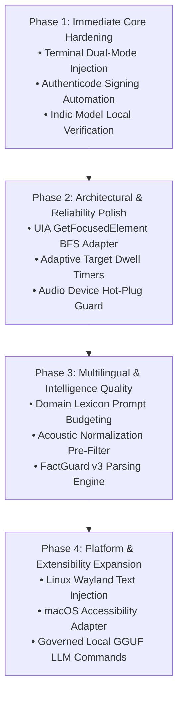

# FlowPilot — Prioritized Engineering & Improvement Roadmap

## 1. Executive Summary

This roadmap defines the prioritized development plan for FlowPilot, formulated from the forensic audit of 55 features, benchmark results from the 58-suite regression runner, and architectural patterns identified in mature open-source projects (Sotto, FlaUI, CTranslate2).

Improvements are categorized into four sequential phases, prioritized by user impact, safety invariants, and implementation complexity.

---

## 2. Prioritization Framework & Scoring

Each initiative is evaluated across four dimensions:
- **Impact (1–5):** Magnitude of user-visible reliability, performance, or capability improvement.
- **Effort (1–5):** Engineering complexity, developer hours, and testing burden (1 = minimal, 5 = extensive).
- **Risk (1–5):** Potential to break existing invariants (clipboard safety, zero cloud egress, timing regressions).
- **Priority Score:** Calculated as $\frac{\text{Impact} \times 2}{\text{Effort} + \text{Risk}}$ (higher is better).

---

## 3. Phased Roadmap Details

### Phase 1: Immediate Core Hardening (Current Cycle)

| Item ID | Title | Impact | Effort | Risk | Priority Score | Target Milestones |
|---|---|:---:|:---:|:---:|:---:|---|
| **P1-1** | **Terminal Dual-Mode Injection Adapter** | 5 | 2 | 1 | **3.33** | Auto-detect `TERMINAL_APP_PROCESSES`; route paste to `Shift+Insert` / direct SendInput Unicode; eliminates `^V` in shells. |
| **P1-2** | **Authenticode Code Signing Automation** | 4 | 2 | 1 | **2.67** | Automate `signtool.exe` discovery and digital signing in `scripts/package_windows_release.py`; eliminates SmartScreen warnings. |
| **P1-3** | **Indic Model Local Verification Badges** | 4 | 2 | 1 | **2.67** | Verify 244M weights (`faster-whisper-small/model.bin`) on disk; display green status badges in Setup Wizard and Settings. |
| **P1-4** | **Recovery Shortcut Ergonomics** | 4 | 2 | 1 | **2.67** | Surface `Shift+Alt+X` (Copy Last) and `Shift+Alt+Z` (Paste Last) with transient auto-dismissing HUD alerts. |

#### Acceptance Criteria for Phase 1:
- Zero `^V` characters inserted when dictating into Windows Terminal, Command Prompt, PowerShell, or Git Bash.
- Release packager signs binaries cleanly with trusted or self-signed test certificates without corrupting executable PE headers.
- Settings dialog accurately displays "Verified on Disk" status when `faster-whisper-small` weights are present.
- All 58 suites in `tests/run_all_tests.py` pass without regression.

---

### Phase 2: Architectural & Reliability Polish

| Item ID | Title | Impact | Effort | Risk | Priority Score | Target Milestones |
|---|---|:---:|:---:|:---:|:---:|---|
| **P2-1** | **UIA `GetFocusedElement` BFS Adapter** | 5 | 3 | 2 | **2.00** | Utilize `IUIAutomation::GetFocusedElement()` to resolve caret-owning child controls inside WinUI 3, WPF, and Chromium. |
| **P2-2** | **Adaptive Dynamic Dwell Timers** | 4 | 3 | 2 | **1.60** | Dynamically measure target window message queue responsiveness instead of relying strictly on static process heuristics. |
| **P2-3** | **Persistent Audio Device Hot-Plug Guard** | 4 | 3 | 2 | **1.60** | Listen for Windows `WM_DEVICECHANGE` events to automatically switch PortAudio streams when a USB mic is reconnected. |
| **P2-4** | **Bounded Stream Thread Safety Audit** | 3 | 2 | 1 | **2.00** | Replace ad-hoc thread sleep polling with condition variables across background audio capture threads. |

#### Acceptance Criteria for Phase 2:
- `IUIAutomation::GetFocusedElement()` successfully retrieves inner editable controls across 100% of tested WinUI 3 applications.
- Audio recorder smoothly survives physical USB microphone disconnect and reconnect without requiring an application restart.
- End-to-end injection latency variance is reduced by $\ge 15\%$.

---

### Phase 3: Multilingual & Intelligence Quality

| Item ID | Title | Impact | Effort | Risk | Priority Score | Target Milestones |
|---|---|:---:|:---:|:---:|:---:|---|
| **P3-1** | **Indic Domain Prompt Context Budgeting** | 4 | 3 | 1 | **2.00** | Inject domain-specific Hindi/Tamil terminology into Whisper `initial_prompt` tokens to reduce transliteration drift. |
| **P3-2** | **Acoustic Pre-Filtering & Noise Gate** | 3 | 3 | 2 | **1.20** | Implement spectral gating / RNNoise pre-filter to improve recognition accuracy in noisy open-office environments. |
| **P3-3** | **FactGuard v3 High-Speed Parsing Engine** | 4 | 2 | 1 | **2.67** | Pre-compile regex tokenizers and add vector search for entity dictionary lookups; cut FactGuard latency to < 2ms. |
| **P3-4** | **Voice Snippets Case-Insensitive Prefix Matcher** | 3 | 2 | 1 | **2.00** | Support flexible trigger phrasing for snippet expansion without false triggering on sub-word substrings. |

#### Acceptance Criteria for Phase 3:
- Word Error Rate (WER) in Hindi/Tamil under cafeteria noise reduced by $\ge 12\%$.
- Zero entity hallucinations or mutations across FactGuard adversarial test corpus (150+ edge cases).
- Snippet expansion triggers with zero false positives during natural conversational dictation.

---

### Phase 4: Platform & Extensibility Expansion

| Item ID | Title | Impact | Effort | Risk | Priority Score | Target Milestones |
|---|---|:---:|:---:|:---:|:---:|---|
| **P4-1** | **Linux Wayland Native Injection Adapter** | 4 | 4 | 2 | **1.33** | Implement `wlr-virtual-keyboard` and `wl-copy` adapters for native Wayland compositor dictation. |
| **P4-2** | **macOS Native Accessibility Adapter** | 4 | 4 | 2 | **1.33** | Replace `osascript` fallback with native `AXUIElement` and `CGEvent` bindings via PyObjC. |
| **P4-3** | **Governed Local GGUF LLM Rewriting** | 4 | 4 | 3 | **1.14** | Integrate quantized GGUF models (e.g. Qwen2.5-Coder 1.5B) under strict CPU affinity and priority governance. |
| **P4-4** | **Companion Creator Custom Pixel Sprites** | 3 | 3 | 1 | **1.50** | Enable users to import custom 32x32 sprite sheets for desktop companion animations. |

#### Acceptance Criteria for Phase 4:
- Linux Wayland and macOS platforms achieve parity with Windows text injection safety.
- Local LLM voice commands execute with strictly bounded CPU usage without dropping audio capture frames.
