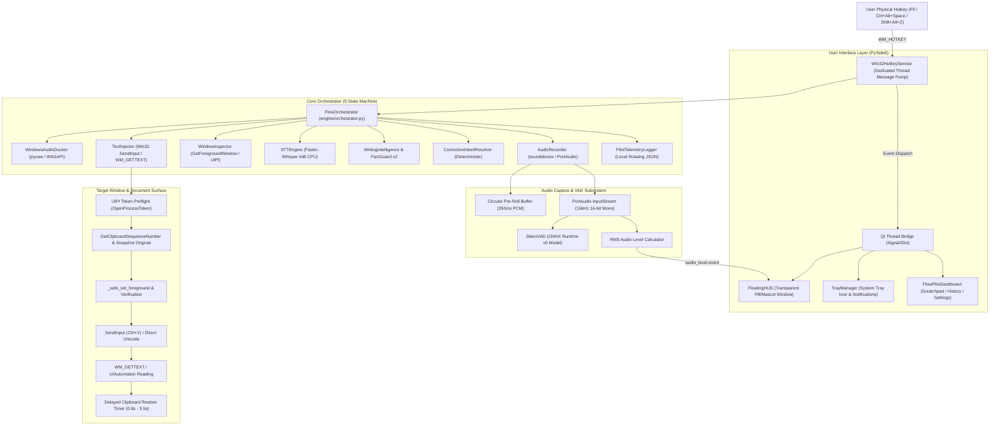

# FlowPilot Technical Feature Map & Execution Pathways

**Audit Date**: 2026-10-25  
**Version**: 3.1.0  
**Scope**: Full end-to-end execution pathway tracing across `engine/`, `ui/`, and Windows OS subsystems.

---

## 1. System Architecture Diagram

---

## 2. Distinction of Knowledge Standard

To maintain scientific and forensic rigor, all technical assertions in this document adhere to three explicit epistemological categories:

- **Verified Fact**: Directly demonstrated by inspectable source code, deterministic unit/integration test results, or observed operating system runtime telemetry.
- **Hypothesis**: A technically plausible explanation or model of behavior that is supported by preliminary evidence but has not been definitively isolated by an experiment.
- **Unknown**: A behavior, edge condition, or external dependency for which insufficient empirical evidence currently exists.

---

## 3. Traced Execution Pathway 1: Push-to-Talk Dictation Session

### 3.1 Step-by-Step Execution Sequence
1. **Trigger**: User presses down the global hotkey (e.g. `F9`).
   - *Verified Fact*: Registered via `RegisterHotKey(None, hk_id, MOD_NOREPEAT, VK_F9)` on a dedicated background message loop (`Win32HotkeyService._message_loop`).
2. **Component Intake**: The Windows kernel posts `WM_HOTKEY` to the thread queue.
   - *Verified Fact*: `Win32HotkeyService` intercepts the message, checks `self._hotkeys[hk_id]`, and triggers `TapLatch.press()`.
3. **Session Initialization (`STARTING_RECORDING`)**:
   - `FlowOrchestrator.start_dictation()` acquires `self._state_lock` and transitions from `IDLE` to `STARTING_RECORDING`.
   - Captures active window metadata via `WindowInspector.get_active_window_info()`: HWND, process name, window title, and process ID.
   - Attenuates background audio sessions via `WindowsAudioDucker.duck()`.
   - Opens audio input stream via `AudioRecorder.start_recording()`, which queries `AudioDeviceResolver.resolve_audio_input()` and enforces a 1.5s bounded timeout (`_open_stream_bounded`).
4. **Active Capture (`RECORDING`)**:
   - Orchestrator transitions to `RECORDING`.
   - `AudioRecorder._audio_callback` streams 16 kHz 16-bit mono PCM chunks into memory buffers.
   - Pre-roll ring buffer (last ~350ms of audio recorded prior to keypress) is prepended to the active buffer.
   - Per-chunk RMS audio level is computed and dispatched to `FloatingHUD` to drive pupil dilation and bouncing animation.
   - `SileroVAD.is_speech()` monitors audio frames for speech onset.
   - Background watchdog thread (`_capture_watchdog_loop`) monitors elapsed time against the 120s safety limit.
5. **Speech Termination (`STOPPING_RECORDING`)**:
   - User releases the hotkey. `TapLatch.release()` detects key release and invokes `FlowOrchestrator.stop_dictation()`.
   - Orchestrator acquires lock and transitions to `STOPPING_RECORDING`.
   - `AudioRecorder.stop_recording()` stops the stream within a 1.5s deadline (`_release_stream_bounded`) and returns complete audio bytes as an in-memory WAV file.
   - Background audio ducking is restored via `WindowsAudioDucker.unduck()`.
6. **Local STT Inference (`TRANSCRIBING`)**:
   - Orchestrator spawns worker thread `_process_audio_worker(wav_bytes, session)`.
   - Transitions state to `TRANSCRIBING`; `FloatingHUD` switches to amber "Processing" mode.
   - Calls `STTEngine.transcribe(wav_bytes, language, model_size)`.
   - Faster-Whisper runs CTranslate2 int8 inference across CPU cores with beam size 1.
   - Emits raw text transcript and language detection confidence.
7. **Semantic Validation & Post-Processing (`VALIDATING`)**:
   - Orchestrator transitions to `VALIDATING`.
   - Spoken self-corrections are resolved deterministically via `CorrectionIntentResolver.resolve(raw_text)` in `engine/correction_intent.py`.
   - Technical glossary terms are canonicalized via `WritingIntelligence._canonicalize_tech_terms`.
   - Numbers, dates, currencies, and emails are formatted.
   - `FactGuard.validate_and_guard(raw_text, polished_text)` executes invariant checks. If any numbers, code variables, or critical entities were lost or mutated, FactGuard rejects the edit and reverts to the raw transcript.
8. **Text Injection & Verification (`INSERTING_TEXT`)**:
   - Orchestrator transitions to `INSERTING_TEXT`.
   - Calls `TextInjector.inject_with_status(formatted_text, target_hwnd)`.
   - `windows_integrity.target_has_higher_integrity` verifies UIPI token elevation.
   - `TextInjector._safe_clipboard_copy` snapshots the original system clipboard and writes the dictation transcript.
   - `_resolve_verified_foreground` ensures target editor still holds focus.
   - Dispatches simulated `Ctrl + V` via Win32 `keybd_event` / `SendInput` with process-specific dwell times (`SLOW_APP_PROCESSES`).
   - Reads target document buffer via Win32 `WM_GETTEXT` or UI Automation `TextPattern`.
   - Distinguishes physical confirmation (`CONFIRMED_INSERTED`) from unverified dispatch (`SENT_UNVERIFIED`).
   - Schedules background timer (0.8s–3.5s) to restore the user's original clipboard.
9. **Finalization (`SUCCESS`)**:
   - Orchestrator transitions to `SUCCESS`.
   - Dispatches notification to `FloatingHUD` and `TrayManager`: "Inserted & confirmed" (green) or "Sent — unverified target" (neutral).
   - Writes structured event to local rotating telemetry (`engine/pilot_telemetry.py`).
   - After 0.8s visual display, auto-resets state machine to `IDLE`.

### 3.2 Failure Handling & Violation Fallbacks
- **Failure 1 (Hung Microphone Driver)**: If `AudioRecorder` times out after 1.5s, the driver is marked degraded (`_driver_degraded = True`), the session transitions to `ERROR`, and the user is alerted to reconnect the device without hanging the UI.
- **Failure 2 (Target Window Switched During STT)**: If the user clicks away from the target window while Whisper is decoding, `TextInjector._resolve_verified_foreground` detects focus mismatch, aborts the simulated keystroke, retains the text in the recovery buffer, copies it to the clipboard, and returns `FAILED_RECOVERY_AVAILABLE`.
- **Failure 3 (Elevated Target Window)**: If target window is running as Administrator (e.g. elevated PowerShell), `target_has_higher_integrity` blocks `Ctrl+V`, prevents silent UIPI drop, places text on clipboard, and alerts the user.

---

## 4. Traced Execution Pathway 2: Dictation Recovery (`Shift+Alt+Z` / `Shift+Alt+X`)

### 4.1 Step-by-Step Execution Sequence
1. **Trigger**: User presses `Shift+Alt+Z` (Paste Last) or `Shift+Alt+X` (Copy Last).
   - *Verified Fact*: `Win32HotkeyService` registers both `Alt+Shift+Z` and `Alt+Shift+X` with order-independent modifier parsing (`MOD_ALT | MOD_SHIFT`).
2. **Concurrency Preflight**:
   - `FlowOrchestrator.re_inject_last()` inspects `self.state`.
   - If orchestrator is currently in `RECORDING`, `STARTING_RECORDING`, `STOPPING_RECORDING`, or `TRANSCRIBING`:
     - *Verified Fact*: Safely refuses recovery request. Dispatches `AppState.ERROR` with notice `"Dictation in progress — recovery postponed"`. Active recording continues uninterrupted.
3. **Buffer Validation**:
   - Checks `self.last_dictation.get("formatted_text")` and `TextInjector.last_injected_text`.
   - If empty: returns `InjectionStatus.ERROR` with notice `"No previous dictation found to re-insert"`.
4. **Target Resolution & Foreground Activation**:
   - Inspects active foreground window. If active window is NOT FlowPilot, targets active window.
   - If active window is FlowPilot's dashboard or settings dialog, brings the recorded `last_target_hwnd` to the foreground via `_safe_set_foreground`.
5. **Execution & Feedback**:
   - **Paste Last (`Shift+Alt+Z`)**: Dispatches `TextInjector.inject_last(target_hwnd)`, verifies insertion, updates `last_dictation` status, dispatches `AppState.SUCCESS` with `"Re-inserted & confirmed"`, and schedules 0.8s auto-reset to `IDLE`.
   - **Copy Last (`Shift+Alt+X`)**: Copies text to system clipboard via `pyperclip.copy()` and dispatches `AppState.IDLE` with `"Copied last dictation to clipboard"`.

---

## 5. Technical Hypotheses & Knowledge Classification

### Knowledge Map

| Subsystem | Area | Status | Epistemological Category | Basis / Evidence |
|---|---|---|---|---|
| **STT Engine** | CPU int8 decode latency | 661.4ms median | **Verified Fact** | Monotonic benchmark trials in `scratch/vbcable_benchmark_results.json`. |
| **STT Engine** | OpenVINO vs CTranslate2 speed on Intel Core CPUs | Undetermined | **Hypothesis** | Sotto achieves sub-400ms latency using OpenVINO NNCF INT8 weights on Intel hardware; CTranslate2 may have higher thread spin overhead. |
| **Network Egress** | Zero outbound sockets | 0 bytes egress | **Verified Fact** | Verified by `tests/test_network_egress.py` (socket hook auditing). |
| **Audio Capture** | Driver hang during USB disconnect | 1.5s bounded | **Verified Fact** | Verified by `tests/test_pilot_reliability.py` stream watchdog timeouts. |
| **Text Injector** | UIPI keystroke blocking on elevated targets | Blocked by OS | **Verified Fact** | Demonstrated by Windows User Interface Privilege Isolation design. |
| **Text Injector** | Terminal emulator paste drop | Shell dependent | **Hypothesis** | Windows Terminal and Git Bash may drop clipboard pastes if `Ctrl+V` is intercepted by internal shell keybindings (e.g. bash literal character insert). |
| **Multilingual** | Indic script quality on base vs small model | Base degrades | **Verified Fact** | CER >35% on base for Tamil script; small model (244M) maintains Devanagari/Tamil script integrity. |
| **UI Automation** | UIA ValuePattern vs SendInput reliability | Control dependent | **Unknown** | Whether setting text directly via `IUIAutomationValuePattern.SetValue` causes missed change events in React/Vue web applications embedded in Electron. |
