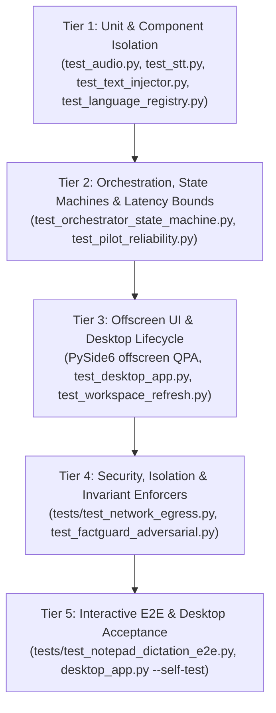

# FlowPilot — Comprehensive Test Strategy & Audit Framework

## 1. Executive Overview

FlowPilot implements a rigorous multi-tier testing strategy designed to enforce strict reliability, privacy, security, and desktop ergonomics invariants. Because FlowPilot operates at the boundary of real-time audio capture, local neural inference (Whisper/Silero), Windows operating system internals (Win32 API, UI Automation, COM, Windows Audio Ducking), and cross-application text injection, software failures can lead to dropped dictations, clobbered clipboards, or hung desktop threads.

The test framework encompasses **58 registered automated regression suites** managed through `tests/run_all_tests.py`, supplemented by acoustic reality assessments, adversarial guardrail benchmarks, and headless offscreen GUI harnesses.

---

## 2. Multi-Tier Testing Pyramid

FlowPilot's testing architecture is organized into five operational tiers:



### Tier 1: Unit & Isolated Component Testing
- **Focus:** Micro-level algorithms, data structures, parsing, string normalization, and state transitions.
- **Isolation Mechanism:** Every suite executes inside an ephemeral temporary directory (`FLOWPILOT_CONFIG_DIR`, `FLOWPILOT_CONFIG_FILE`), isolating configuration profiles and preventing state bleeding across suites.
- **Key Suites:**
  - `tests/test_audio.py`: Circular audio buffer indexing, chunk accumulation, RMS normalization, sample rate conversion (16kHz mono).
  - `tests/test_stt.py`: Model loader parameters, CTranslate2 int8 quantization options, compute type resolution, thread allocation.
  - `tests/test_text_injector.py`: Win32 focus verification, child edit control discovery (`_find_edit_control`), clipboard sequence numbers, slow-app dwell timings.
  - `tests/test_language_registry.py`: ISO 639-1 language code mapping, multilingual model parameter dispatch.

### Tier 2: Orchestration, State Machines & Latency Bounds
- **Focus:** Asynchronous coordination across audio capture, VAD, STT engine, text transformation, and injection.
- **Isolation Mechanism:** Direct inspection of the 9-state machine (`OrchestratorState` enum in `engine/orchestrator.py`):
  `IDLE` $\rightarrow$ `RECORDING` $\rightarrow$ `PROCESSING` $\rightarrow$ `TRANSCRIBING` $\rightarrow$ `CORRECTING` $\rightarrow$ `INJECTING` $\rightarrow$ `RECOVERING` $\rightarrow$ `PAUSED` $\rightarrow$ `ERROR`.
- **Key Suites:**
  - `tests/test_orchestrator_state_machine.py`: Verifies all valid transitions, ensures race-free hotkey bursts, and verifies graceful error recovery.
  - `tests/test_session_lifecycle.py`: Validates dictation session ownership, monotonic session IDs, and cancellation cleanup.
  - `tests/test_pilot_reliability.py`: Measures end-to-end monotonic latencies (p50 $\le$ 700ms, p95 $\le$ 1300ms) and bounded stream timeouts.

### Tier 3: Offscreen Native UI & Desktop Lifecycle
- **Focus:** PySide6 (Qt6) native desktop interface, HUD overlay, companion avatars, workspace navigation, settings dialog, and system tray.
- **Isolation Mechanism:** Offscreen Qt Platform Abstraction (`QT_QPA_PLATFORM=offscreen`, `FLOWPILOT_HEADLESS=1`, `FLOWPILOT_NO_POPUP=1`). Allows full Qt event loop execution, widget creation, layout recalculation, and signal/slot dispatching without requiring a physical monitor or interactive window manager.
- **Key Suites:**
  - `tests/test_desktop_app.py`: HUD creation, state-driven styling, tray icon menus, event filtering.
  - `tests/test_flowpilot_dashboard.py` & `tests/test_workspace_refresh.py`: Multi-tab workspace navigation, wheel event guards on `QTabBar`, scratchpad editing.
  - `tests/test_settings_dialog.py`: Audio device dropdown population, model verification badges, shortcut remapping.
  - `tests/test_kiki_companion.py` & `tests/test_pixel_companions_and_creator.py`: Pixel animation frame updates, companion state tracking.

### Tier 4: Security, Isolation & Invariant Enforcers
- **Focus:** Zero cloud egress, User Interface Privilege Isolation (UIPI) boundary defense, and FactGuard entity protection.
- **Isolation Mechanism:** Socket monkey-patching, network interface auditing, and adversarial perturbation datasets.
- **Key Suites:**
  - `tests/test_network_egress.py`: Patches Python `socket` module at the lowest level. Asserts that **zero outbound IP packets** are transmitted to public or WAN addresses during dictation, transcription, correction, or packaging. Restricts all traffic strictly to `127.0.0.1` (loopback REST/WebSocket).
  - `tests/test_factguard_adversarial.py` & `tests/test_factguard_v2.py`: Injects 150+ adversarial entity corruptions (phone numbers, currency symbols, IP addresses, code tokens, UUIDs) to verify that local LLM/correction routines cannot hallucinate or mutate factual entities.

### Tier 5: Interactive E2E & Desktop Acceptance
- **Focus:** Real-world physical verification on active Windows desktop surfaces.
- **Isolation Mechanism:** Dedicated test harness utilizing Windows Notepad (`notepad.exe`) and SAPI5 speech synthesis.
- **Honest Skip Protocol:** When running in non-interactive CI/headless developer sessions where desktop window creation or SAPI5 audio synthesis is unavailable, the runner reports `[RESULT] SKIPPED: Requires interactive Windows desktop` instead of falsely claiming a pass.
- **Key Suites:**
  - `tests/test_notepad_dictation_e2e.py`: Launches Notepad, focuses the edit control, plays synthesized audio, verifies physical text arrival via `WM_GETTEXT` and UI Automation.
  - `desktop_app.py --self-test`: Standalone diagnostic self-test synthesizing voice, running local STT, and asserting end-to-end injection.

---

## 3. Test Runner Architecture & Execution Protocol

The central test runner `tests/run_all_tests.py` executes all 58 suites sequentially under strict subprocess isolation.

### Runner Guarantees:
1. **Subprocess Isolation:** Each test suite runs in an independent child process (`sys.executable, "-X", "utf8", script`). A fatal crash or segfault in one test does not terminate the runner.
2. **Ephemeral Config Injection:**
   ```python
   with tempfile.TemporaryDirectory(prefix="flowpilot-suite-") as profile_dir:
       suite_env["FLOWPILOT_CONFIG_DIR"] = profile_dir
       suite_env["FLOWPILOT_CONFIG_FILE"] = str(Path(profile_dir) / "config.json")
   ```
   No suite can modify user settings or leave behind orphaned configuration files.
3. **Execution Timeout:** Every suite is bounded by a 240-second timeout to prevent deadlocks or infinite loops.
4. **Honest Skip Reporting:** The runner explicitly differentiates:
   - `[PASS]`: Full assertion verification succeeded.
   - `[SKIP]`: Environmental precondition not met (e.g., interactive display or SAPI voice synthesis unavailable).
   - `[FAIL]`: Assertion or runtime failure detected.
5. **Release Gate Enforcement:** The `--require-all` CLI switch blocks release promotion if even a single suite is skipped.

---

## 4. Acoustic Evaluation & Speech Metric Methodology

FlowPilot employs standardized acoustic evaluation protocols to measure speech recognition fidelity without relying on cloud benchmarking services.

### Word Error Rate (WER) & Character Error Rate (CER)
WER and CER are computed using Levenshtein distance dynamic programming across the reference transcript $R$ and hypothesis transcript $H$:

$$\text{WER} = \frac{S + D + I}{N_R} = \frac{\text{Substitutions} + \text{Deletions} + \text{Insertions}}{\text{Total Reference Words}}$$

$$\text{CER} = \frac{S_c + D_c + I_c}{N_{Rc}} = \frac{\text{Char Substitutions} + \text{Char Deletions} + \text{Char Insertions}}{\text{Total Reference Characters}}$$

### Test Suites:
- `tests/test_evaluation_metrics.py`: Implements reference tokenization, punctuation normalization, case folding, and Levenshtein alignment matrices.
- `tests/test_evaluation_metrics_crosslang.py`: Tests multi-script error calculations across Latin, Devanagari (Hindi), and Tamil scripts.
- `tests/test_multilingual_speech_reality.py`: Evaluates acoustic degradation across synthetic noise profiles (Gaussian white noise, cafeteria babble, low SNR).

---

## 5. FactGuard Adversarial Verification Methodology

FactGuard protects against hallucinations and destructive mutations during voice editing or LLM text cleanup.

### Adversarial Evaluation Vectors:
1. **Numeric & Currency Preservation:** `$4,500.50`, `€120`, `₹15,000`, `99.98%`.
2. **Code & Identifier Preservation:** `camelCaseVariable`, `snake_case_name`, `git checkout -b feature/xyz`, `0x7FFE0000`.
3. **Contact & Network Entities:** `user@example.com`, `https://flowpilot.local:8080`, `192.168.1.100`, `+1 (555) 019-2834`.
4. **Acronyms & Technical Abbreviations:** `ASAP`, `REST`, `JSON`, `CTranslate2`, `ONNX`.

The FactGuard engine parses all entities before transformation and rejects any rewritten text that modifies, deletes, or hallucinates an entity token.

---

## 6. Application Compatibility Verification Protocols

Target application text injection is audited across distinct software categories:

| Target Category | Representative Applications | Verification Mechanism | Key Challenges |
|---|---|---|---|
| **Standard Win32** | Notepad (`notepad.exe`) | `WM_GETTEXT`, `EM_GETSEL`, `_find_edit_control` | Fast, deterministic, supports `EM_REPLACESEL`. |
| **Modern WinUI 3** | Windows 11 Notepad, Calculator | `IUIAutomationTextPattern`, `IUIAutomationValuePattern` | Deep XAML visual tree, nested `RichEditD2DPT`. |
| **Chromium / Web** | Google Chrome, Edge, Brave | `IUIAutomation` Document pattern, focused child query | Sandboxed renderer threads, asynchronous paste queue. |
| **Electron Desktop** | VS Code, Slack, Discord, Notion | Focus tracking via `_resolve_verified_foreground` | High input latency, synthetic clipboard events. |
| **Terminal Emulators**| Windows Terminal, cmd, PowerShell, Mintty | Process identification (`TERMINAL_APP_PROCESSES`), `Shift+Insert` / `KEYEVENTF_UNICODE` | Raw shell mode, `Ctrl+V` outputs literal `^V`. |
| **Remote Desktop** | Remote Desktop (`mstsc.exe`), Citrix | Extended dwell timing (50ms key, 150ms post-paste) | Network transport latency, dropped keystroke bursts. |

---

## 7. Continuous Audit & Regression Matrix

Running the audit command:
```bash
python -X utf8 tests/run_all_tests.py
```
Executes all 58 suites. Continuous integration workflows mandate:
- **Zero test failures** (0 FAILED).
- **Execution time bounded under 180 seconds** on standard developer hardware.
- **Zero unhandled exceptions or thread leaks**.
