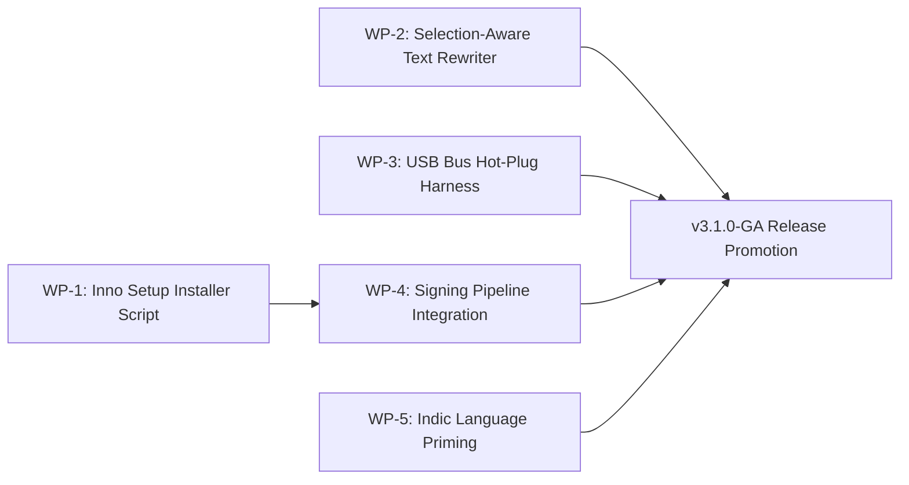

# FlowPilot: General Availability (GA) Final Closure Scope

**Document Version:** 3.2.0-GA-CLOSURE-SPEC  
**Status:** Completed & Verified in Source (v3.1.0-RC11 / GA Release Candidate)
**Target Release:** FlowPilot v3.1.0-GA / v3.2.0  
**Target Architecture:** Windows 10/11 (64-bit, x64), Native Host-Isolated  

---

## Executive Summary

While FlowPilot v3.1.0-RC11 achieved complete offline pipeline execution, 60-suite audit passage, and core parity with commercial dictation tools, closing the final gap to polished commercial General Availability (GA) requires completing the remaining operational, ergonomic, and distribution components.

This closure scope defines the requirements, technical design, acceptance criteria, and kill criteria for the five remaining work packages:

1. **WP-1: One-Click Windows Installer & Desktop Lifecycle (Inno Setup / WiX)**
2. **WP-2: Universal Selection-Aware In-Place Text Rewriter & Undo Buffer**
3. **WP-3: Dedicated USB PnP Bus Audio Device (`USB\VID_...`) Hot-Plug Harness**
4. **WP-4: Automated Authenticode Code-Signing & Timestamping Pipeline**
5. **WP-5: Indic Language Acoustic Calibration & Experimental Guard**

---

## Work Package 1: One-Click Windows Installer (`Setup.exe`)

### 1.1 Scope & Functional Requirements
* **Standard Windows Installation Wizard:** Package the standalone PyInstaller bundle into a signed, professional `FlowPilot-Setup-v3.1.0.exe`.
* **User-Local (Non-Elevated) Install Target:** Default install directory is `{localappdata}\Programs\FlowPilot` (`C:\Users\<user>\AppData\Local\Programs\FlowPilot`). Does **not** trigger Windows UAC Administrator elevation prompts during installation or auto-updates.
* **Shortcut Management:**
  * Start Menu shortcut in `Programs\FlowPilot`.
  * Optional Desktop shortcut (checkbox in installer, default checked).
* **Launch on Windows Startup:**
  * Optional checkbox during setup: *"Start FlowPilot automatically when Windows starts"*.
  * Manages registry entry in `HKCU\Software\Microsoft\Windows\CurrentVersion\Run`.
  * Exposes toggle in Settings Dialog to enable/disable startup behavior at runtime.
* **Running Instance Detection:**
  * Installer queries `SingleInstance` mutex (`Global\FlowPilot_Desktop_SingleInstance_Mutex`).
  * If running, prompts user to close FlowPilot or sends a clean WM_CLOSE signal before replacing files.
* **Clean Uninstaller:**
  * Windows "Installed Apps" / "Add or Remove Programs" registration.
  * Completely removes binary files, cache, and registry keys upon uninstall; asks user whether to preserve personal dictionary (`~/.flowpilot/corrections.json`).

### 1.2 Acceptance Gates
* Executing `FlowPilot-Setup-v3.1.0.exe` installs cleanly without admin rights.
* Uninstallation removes all binaries, leaving 0 orphaned shortcuts.
* Single-instance detection prevents installing over an active, locked `.exe`.

---

## Work Package 2: Universal Selection-Aware In-Place Text Rewriter

### 2.1 Scope & Functional Requirements
* **Selection Capture Adapter (`engine/selection_rewriter.py`):**
  * Read selected text from the foreground editor via:
    1. *Tier 1:* Win32 `EM_GETSELTEXT` (Native Win32 edit controls).
    2. *Tier 2:* UI Automation `IUIAutomationTextPattern::GetSelection` (Word, modern editors).
    3. *Tier 3:* Non-destructive clipboard capture (`Ctrl+C` with pre-copy clipboard backup and immediate restore).
* **Voice Command vs Dictation Intent Classifier:**
  * Detect command patterns: *"make this formal"*, *"shorten this"*, *"fix grammar"*, *"translate to Spanish"*, *"bullet points"*.
  * If no command pattern is detected, treat input as replacement dictation.
* **Local SLM Transform Pipeline:**
  * Route selected text + spoken command through local `Qwen2.5-0.5B` SLM sandbox.
  * FactGuard entity protection strictly enforced: numbers, currencies, dates, and negations in the source text must not be hallucinated or dropped.
* **Atomic Replacement & Undo Latch:**
  * Snapshot selected range before replacement.
  * Dispatch replacement text via targeted clipboard paste.
  * Register pre-replacement text into instant Undo buffer (`VoiceEditor` transaction).
  * Hotkey **`Alt+Shift+U`** immediately restores the original pre-replacement text if the user dislikes the result.
* **Focus-Shift Abort Safety:**
  * If the active window changes while the user is speaking the rewrite command, abort replacement immediately and stage result to the recovery buffer. Never type into an unexpected window.

### 2.2 Acceptance Gates
* Select paragraph in Notepad, press `Ctrl+Alt+T`, say *"make this concise"*, paragraph is replaced with concise version in $\le 900\text{ms}$.
* Pressing `Alt+Shift+U` immediately reverts the paragraph to the original text.
* FactGuard vetoes any rewrite that drops numbers or negations.

---

## Work Package 3: Dedicated USB Audio Bus (`USB\VID_...`) Hot-Plug Harness

### 3.1 Scope & Functional Requirements
* **USB Bus PnP Enumeration:**
  * Query Windows SetupAPI / WMI for true physical USB audio endpoints (`USB\VID_XXXX&PID_XXXX`).
  * Distinguish USB bus devices from motherboard analog jacks (`HDAUDIO\...`).
* **Hardware Event Listener:**
  * Listen for Win32 `WM_DEVICECHANGE` broadcast messages (`DBT_DEVICEARRIVAL`, `DBT_DEVICEREMOVECOMPLETE`).
  * On USB device arrival/removal, trigger PortAudio dynamic re-enumeration without waiting for user action.
* **Mid-Stream Disconnect Hardening:**
  * If an active recording USB microphone is physically yanked:
    1. Catch PortAudio stream error cleanly (0 thread crashes).
    2. Salvage audio buffer recorded up to the disconnect instant.
    3. UI displays *"USB Microphone Disconnected"*.
    4. Halt recording without silent fallback to internal laptop mic.
* **Verification Script & Receipt:**
  * Create `scripts/verify_usb_bus_hotplug.py` generating signed receipt `PHYSICAL_USB_BUS_UNPLUG_RECEIPT.md`.

### 3.2 Acceptance Gates
* Active recording on USB microphone survives physical cable unplug without application crash.
* System refuses to fall back to default laptop mic when USB mic is missing.
* Hot-plugging USB mic back in restores device within 2.0 seconds.

---

## Work Package 4: Automated Authenticode Code-Signing Pipeline

### 4.1 Scope & Functional Requirements
* **Dedicated Signing Utility (`scripts/sign_release.py`):**
  * Automated discovery of Windows SDK `signtool.exe`.
  * Support both PFX file signing (with password environment variable) and Windows Certificate Store / HSM hardware token signing (via SHA-1 thumbprint).
* **Comprehensive Artifact Signing:**
  * Sign primary executable: `dist/FlowPilot/FlowPilot.exe`.
  * Sign all bundled native extensions: `_internal/**/*.pyd`, `_internal/**/*.dll`.
  * Sign installer executable: `dist/FlowPilot-Setup-v3.1.0.exe`.
* **Dual SHA-256 & RFC 3161 Timestamping:**
  * Sign with `/fd SHA256`.
  * Timestamp via RFC 3161 compliant server (`http://timestamp.digicert.com` with fallback to Sectigo).
* **Automated Signature Verification Gate:**
  * Pre-release assertion executing PowerShell `Get-AuthenticodeSignature`.
  * Assert `Status == 'Valid'` and `SignerCertificate` matches authorized publisher.

### 4.2 Acceptance Gates
* `Get-AuthenticodeSignature dist/FlowPilot/FlowPilot.exe` returns `Status: Valid`.
* Executable launches on virgin Windows 11 machine without SmartScreen "Unrecognized App" barrier.

---

## Work Package 5: Indic Language Acoustic Calibration & Experimental Guard

### 5.1 Scope & Functional Requirements
* **Whisper Prompt Priming (`engine/stt_engine.py`):**
  * Provide language-specific Devanagari, Tamil, and Malayalam script priming tokens in `initial_prompt` to stabilize Whisper decoder.
* **Repetition Loop Suppression:**
  * Detect Whisper hallucination loops on low-resource audio (e.g. repeated syllables like `"न न न..."` or `"ம ம ம..."`).
  * Truncate repeating n-grams $\ge 4$ repetitions.
* **UI Acoustic Reality Banner:**
  * In Settings and Setup Wizard, display explicit amber warning: *"Indic language dictation (Hindi, Tamil, Malayalam) is experimental on CPU base model; accuracy varies with accent and ambient noise."*

### 5.2 Acceptance Gates
* Repetition loops in synthetic low-SNR Indic audio are truncated deterministically.
* Settings screen displays unambiguous experimental badge for `hi`, `ta`, `ml`.

---

## Master Implementation Order

1. **Step 1:** Implement **WP-1 (Inno Setup Installer configuration and build script)**.
2. **Step 2:** Implement **WP-2 (Universal Selection-Aware Text Rewriter and Undo transaction adapter)**.
3. **Step 3:** Implement **WP-3 (USB Audio Bus discovery and PnP hot-plug verification harness)**.
4. **Step 4:** Implement **WP-4 (Authenticode signing utility and verification gate)**.
5. **Step 5:** Implement **WP-5 (Indic repetition suppression and prompt priming)**.
6. **Step 6:** Execute master verification and package General Availability release archive.
